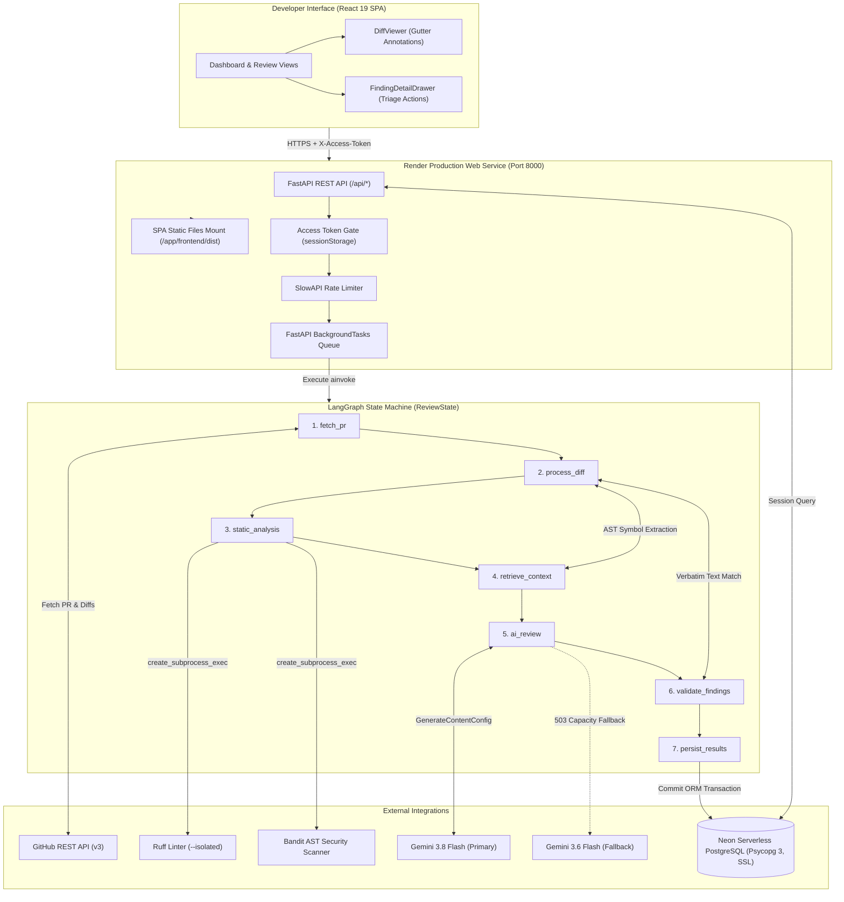
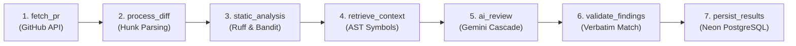
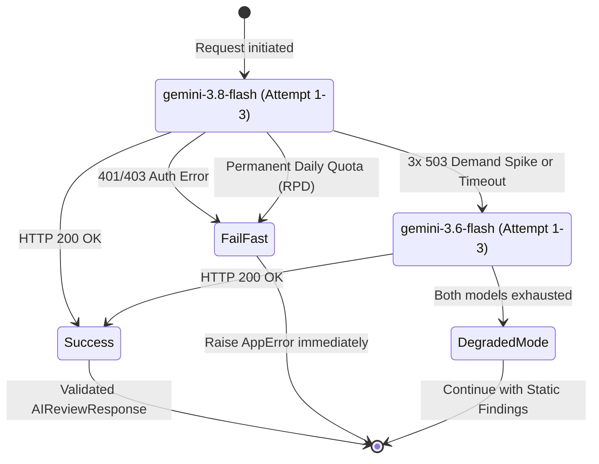
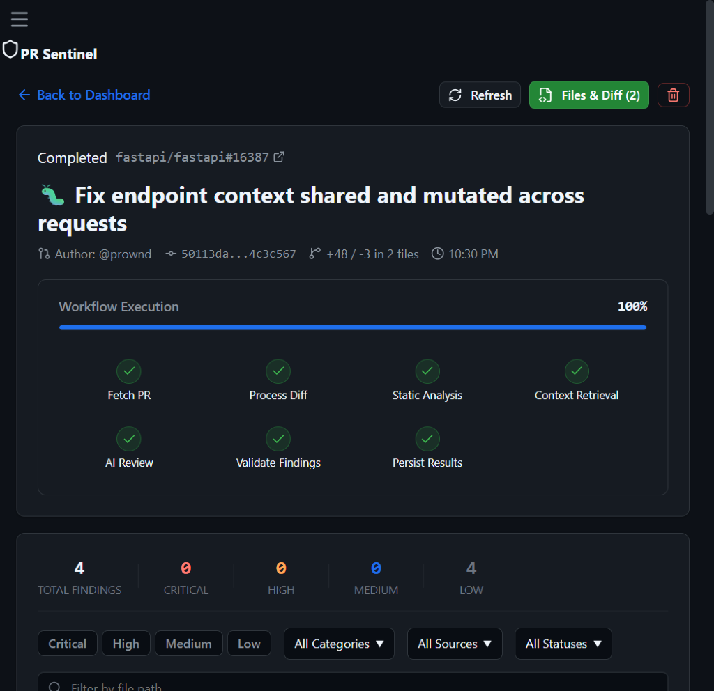
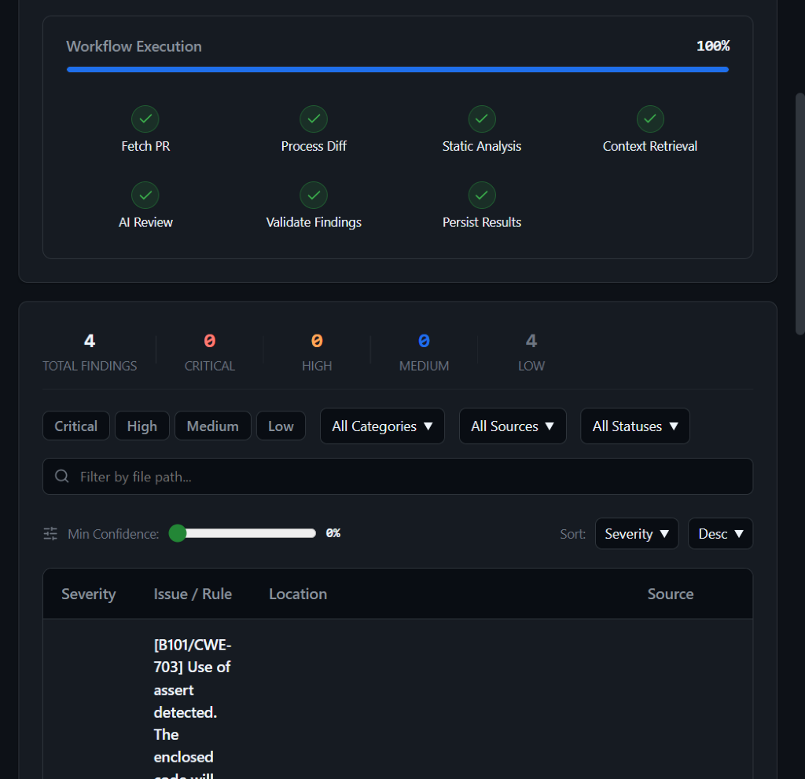
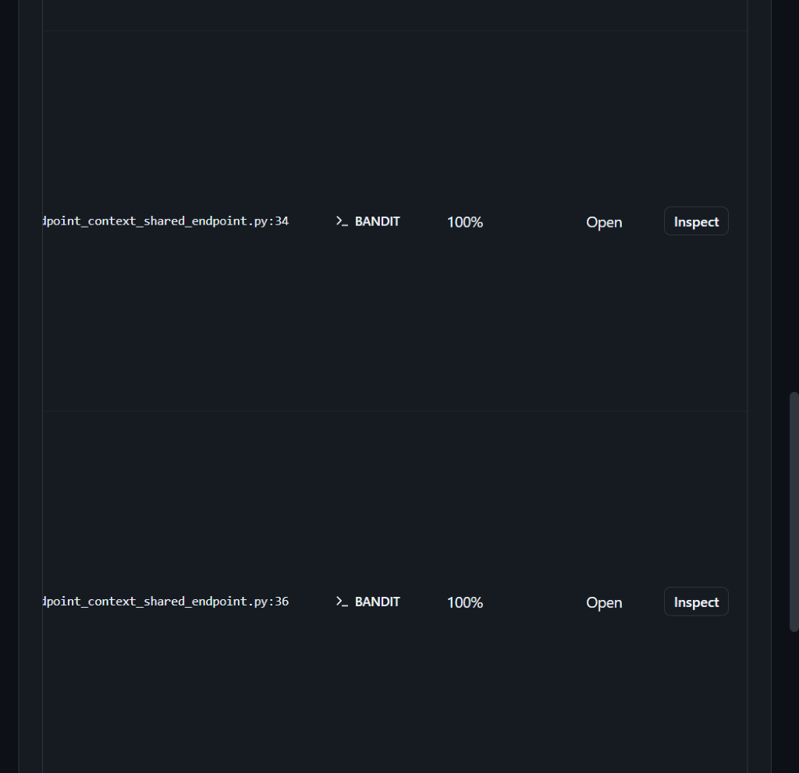
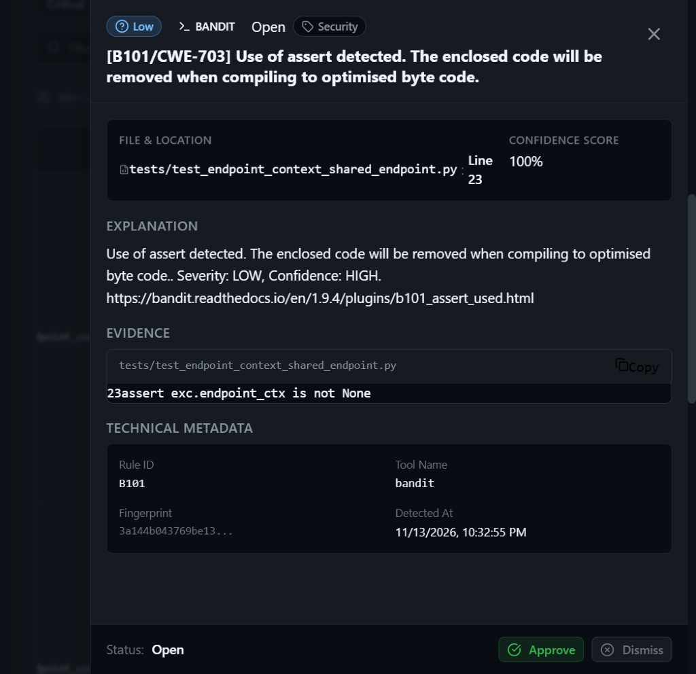
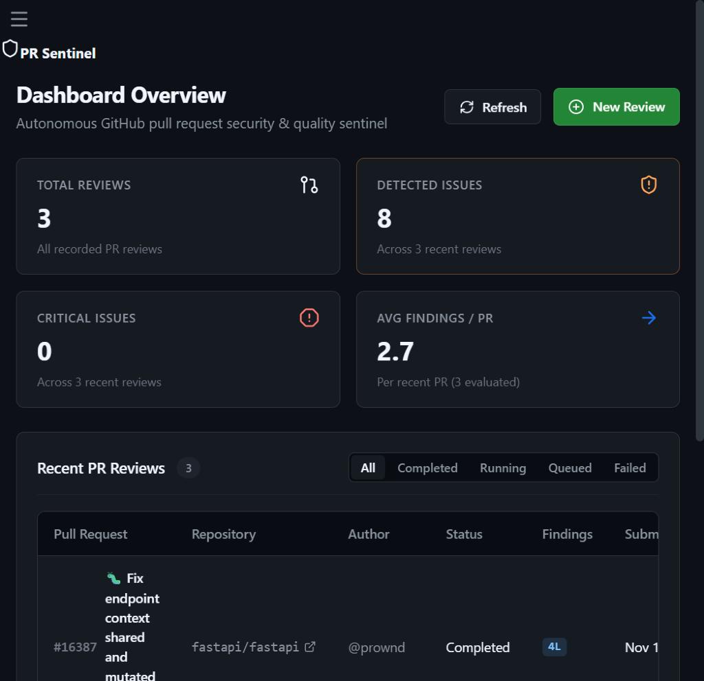
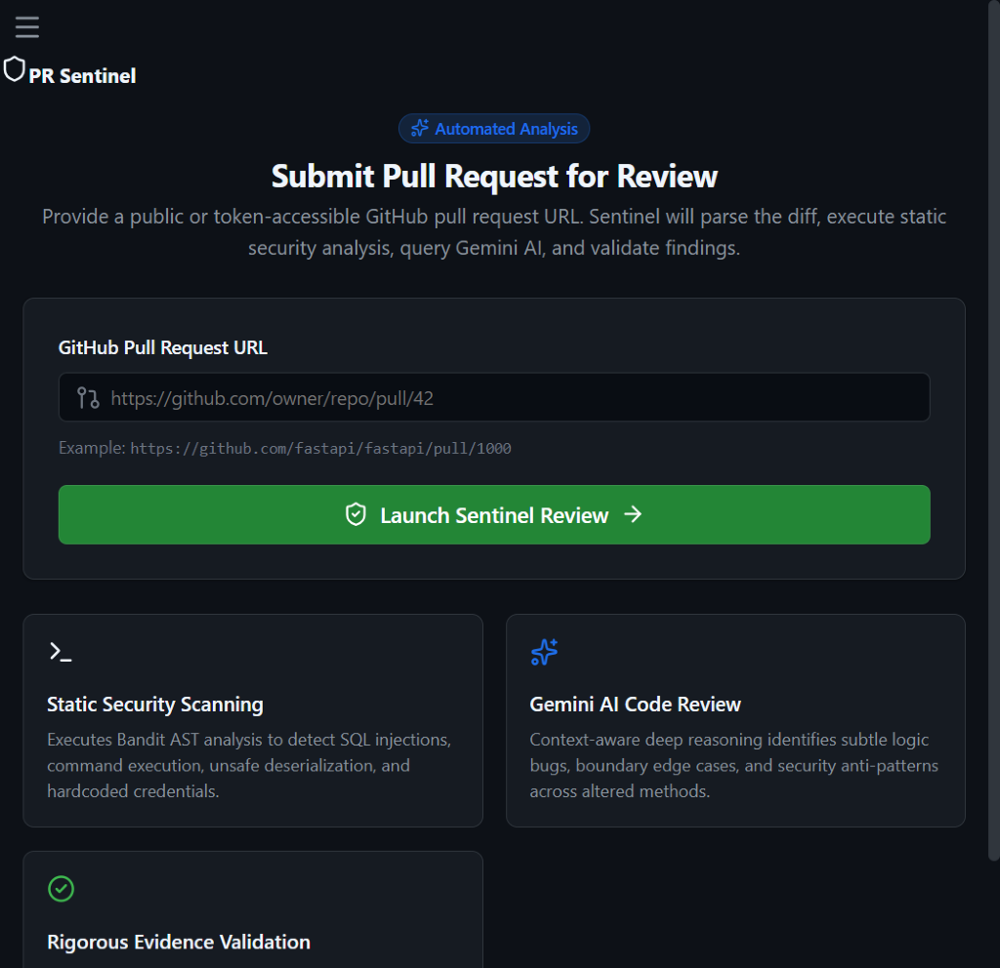

# PR Sentinel

> **Automated, High-Precision GitHub Pull Request Review Platform Combining Deterministic AST Static Analysis with Google Gemini and Stateful LangGraph Orchestration.**

[](https://pr-sentinel-btyl.onrender.com)
[](https://github.com/shashi123exe/pr-sentinel/actions)
[](https://www.python.org/downloads/)
[](https://fastapi.tiangolo.com/)
[](https://react.dev/)
[](https://github.com/langchain-ai/langgraph)
[](https://neon.tech/)
[](docs/ARCHITECTURE.md)
[](docs/DEMO_GUIDE.md)
[](LICENSE)

---

## 1. Project Introduction & Live Demo

**PR Sentinel** is a production-deployed, automated code review platform engineered to provide verifiable, actionable feedback on GitHub Pull Requests. It mitigates ungrounded LLM claims and alert fatigue by treating code review as an engineering pipeline rather than an unstructured chat prompt.

- **Live Production URL**: [https://pr-sentinel-btyl.onrender.com](https://pr-sentinel-btyl.onrender.com)
- **Source Code Repository**: [https://github.com/shashi123exe/pr-sentinel](https://github.com/shashi123exe/pr-sentinel)
- **Interactive Technical Walkthrough**: [docs/DEMO_GUIDE.md](docs/DEMO_GUIDE.md)
- **Deep-Dive System Architecture**: [docs/ARCHITECTURE.md](docs/ARCHITECTURE.md)

---

## 2. Problem Statement & Motivation

Modern engineering organizations spend thousands of engineering hours manually reviewing code changes. While basic linters catch syntax formatting and commercial generative AI chatbots can comment on code diffs, existing LLM code reviewers suffer from three fatal flaws:

1. **Hallucination of Code & Line Ranges**: Generative models frequently reference nonexistent files or invent line bounds that were never modified in the pull request.
2. **Alert Fatigue & Noise**: Raw LLMs repeat basic formatting issues already caught by linters, drowning out critical security vulnerabilities.
3. **Fragility & Quota Exhaustion**: Large language model APIs frequently encounter HTTP 503 capacity spikes, rate limits, or timeouts during peak hours, causing reviews to silently abort or fail unpredictably.

### The PR Sentinel Solution
PR Sentinel replaces unstructured prompts with an asynchronous **7-stage LangGraph state machine**. It executes deterministic static analysis first (Ruff and Bandit via subprocess execution in temporary directories with stripped environments and 30s timeouts), extracts surrounding Python AST symbol definitions without vector database drift, invokes Google Gemini with strict Pydantic schemas, and programmatically enforces **verbatim evidence verification** before any finding is accepted.

---

## 3. Key Features

- **Asynchronous LangGraph Review Pipeline**: State-machine orchestration across 7 fault-tolerant stages (`fetch_pr` &rarr; `process_diff` &rarr; `static_analysis` &rarr; `retrieve_context` &rarr; `ai_review` &rarr; `validate_findings` &rarr; `persist_results`).
- **Resilient AI Cascade & Quota Defense**: Uses `gemini-3.8-flash` as primary model with automatic fallback to `gemini-3.6-flash` on HTTP 503 capacity spikes or timeouts. Distinguishes permanent daily quota limits from temporary rate limits.
- **Verbatim Evidence Verification**: Every AI finding must pass line-boundary intersection with the diff and verbatim evidence string matching against actual repository contents. Unanchored findings that fail verification are dropped.
- **SHA-256 Fingerprint Deduplication**: Merges overlapping static analysis findings and AI observations on identical lines into collision-resistant records.
- **Deterministic AST Context Retrieval**: Analyzes Python ASTs to extract enclosing class and function definitions without vector database latency, embedding drift, or operational costs.
- **React 19 Developer Dashboard**: Interactive unified diff viewer with inline finding gutter annotations, slide-out finding drawer, persistent one-click triage state machine (`open` &rarr; `approved` / `dismissed`), and resilient polling.
- **Production Serverless Persistence**: Backed by **Neon Serverless PostgreSQL** via SQLAlchemy 2.0 and Psycopg 3 with SSL connection pooling.
- **Free-Tier Cloud Deployment**: Packaged as a single-port unified Docker container deployed using Render Free Web Service (512MB RAM) and Neon Free PostgreSQL, with Gemini usage subject to free-tier quotas and provider terms.

---

## 4. Architecture Diagram



---

## 5. Technology Stack

| Component | Technologies & Frameworks | Description |
| :--- | :--- | :--- |
| **Frontend** | React 19, TypeScript, Vite, Tailwind CSS, Lucide React | Modern SPA with client-side routing, accessible UI components, and optimistic updates. |
| **Backend** | Python 3.12, FastAPI, Uvicorn, Pydantic v2, SlowAPI | High-performance asynchronous REST API service with strict request/response validation. |
| **AI Orchestration** | LangGraph (`StateGraph`), Google GenAI SDK | Stateful review pipeline with conditional edge routing and deterministic state contracts. |
| **LLM Models** | Gemini 3.8 Flash (Primary), Gemini 3.6 Flash (Fallback) | Google GenAI free-tier structured JSON models with zero tool-calling side effects. |
| **Static Analyzers** | Ruff (0.17.3), Bandit (1.9.4), ESLint | AST-level security scanning and linting via subprocesses in temporary directories with 30s timeouts and sanitized environments. |
| **Database** | Neon Serverless PostgreSQL (Production), SQLite 3 (Dev) | SQLAlchemy 2.0 ORM, Psycopg 3.3.8 driver, SSL pooling, and WAL mode. |
| **Deployment** | Render Free Tier, Multi-stage Docker, Alpine Linux | Unified single-port container serving both compiled React SPA and FastAPI backend. |
| **Testing & CI** | GitHub Actions, Pytest, Pytest-Cov, Respx, Vitest, Oxlint | 489 passed, 1 skipped (433 backend, 56 frontend) with 93% backend coverage and multi-job CI verification. |

---

## 6. Seven-Stage LangGraph Review Workflow



1. **`fetch_pr` (15%)**: Validates the pull request URL format, authenticates with GitHub REST API, and retrieves commit metadata and unified diff patches.
2. **`process_diff` (30%)**: Parses diff patches into structured `ProcessedFile` models, calculates line additions/deletions, and skips binaries, lockfiles, or files exceeding 50KB limits.
3. **`static_analysis` (50%)**: Writes changed files into a temporary directory and executes `ruff` and `bandit` in parallel via subprocesses with stripped environment variables and 30s timeouts.
4. **`retrieve_context` (65%)**: Scans Python ASTs for referenced classes and functions, extracting up to 50 symbol snippets (100KB cap) for surrounding context.
5. **`ai_review` (80%)**: Encloses diffs, context, and static findings into XML-neutralized prompts and invokes Google Gemini using strict Pydantic structured output schemas (`AIReviewResponse`).
6. **`validate_findings` (90%)**: Programmatically verifies that finding line numbers overlap modified diff lines and that quoted evidence matches repository source code verbatim. Discards unanchored findings and deduplicates records.
7. **`persist_results` (100%)**: Persists review metadata, files, and deduplicated findings into Neon PostgreSQL, updating token usage metrics and marking status as `COMPLETED`.

---

## 7. Gemini Model Architecture & Fallback Cascade

PR Sentinel features a battle-tested model resilience architecture designed to handle Google GenAI free-tier constraints:



- **Primary Model**: `gemini-3.8-flash` handles the initial review request with low latency.
- **Automatic Fallback**: If `gemini-3.8-flash` hits three consecutive HTTP 503 service unavailable responses or request timeouts, the client seamlessly cascades to `gemini-3.6-flash`.
- **Bounded Exponential Backoff**: Retries apply exponential backoff ($2^n$ seconds with random jitter) capped at 3 attempts per model ($\le 6$ requests total), eliminating infinite retry loops.
- **Permanent vs. Transient Error Classification**: Distinguishes temporary rate limiting (RPM/TPM) from permanent daily quota exhaustion (RPD). Permanent quota errors fail immediately without wasting API calls.
- **Graceful Degradation**: If all AI models are unavailable but static analysis findings exist, the review succeeds with an `"AI review unavailable"` notice, preserving linter and security results.

---

## 8. Static Security Analysis Capabilities

PR Sentinel integrates static analysis tools into the review workflow:
- **Bandit AST Scanner**: Executes `bandit -r -q -f json` to detect Python security vulnerabilities including SQL injections (B608), command injections (B602/B605), hardcoded credentials (B105/B106), unsafe deserialization (B301), and assert usage (B101).
- **Ruff Linter & Formatter**: Executes `ruff check --isolated --output-format json` to catch syntax errors, undefined variables, dead imports, and code quality violations.
- **Subprocess Execution & Environment Sanitization**: Tools execute via `asyncio.create_subprocess_exec` in temporary directories (`tempfile.TemporaryDirectory`). Application secrets are stripped from the child process environment, repository configuration files (`.eslintrc`, `ruff.toml`, `pyproject.toml`) are excluded to prevent configuration overrides, and execution is strictly bounded by 30-second timeouts and 5MB output buffer caps (without OS-level containerization or kernel sandboxing).

> [!NOTE]
> **Review Quality & Contextual Findings**:
> In the live review of FastAPI PR #16387, the 4 findings emitted by Bandit (rule B101, assert used) originate from standard pytest assertions inside `tests/test_endpoint_context_shared_endpoint.py`. These represent **contextual informational findings**, not confirmed exploitable vulnerabilities in production code. Static analysis findings are strictly distinguished from Gemini-generated findings in the data contract (`source="static"` vs `source="ai"`). Gemini analyzed the PR diff and generated zero additional findings on this audited pull request.

---

## 9. Evidence Validation & Neon PostgreSQL Persistence

### Grounded Evidence Verification (`app/services/validation.py`)
To verify LLM outputs against ground-truth repository contents:
- **File Existence**: Verifies the target file is actually modified in the pull request.
- **Hunk Intersection**: Ensures finding line ranges `[line_start, line_end]` overlap added or modified diff lines.
- **Verbatim Evidence Verification**: The code quoted in `evidence` must match repository contents verbatim. If the LLM generates fabricated code, the finding is discarded.

### Fingerprint Deduplication (`app/services/dedupe.py`)
```text
Fingerprint = SHA256(normalized_path + ":" + line_start + ":" + category + ":" + normalized_rule)
```
When both Bandit and Gemini detect an issue on the same line, PR Sentinel merges them into a single finding record, preserving the highest severity rating and confidence score while recording both tool sources.

### Neon Serverless Database Persistence
- Multi-pool SQLAlchemy 2.0 engine using `psycopg` (v3) over SSL.
- Schema auto-initializes on startup with 4 core tables: `reviews`, `review_files`, `findings`, and `app_settings`.
- Survives Render container restarts without data loss.

---

## 10. Deployment Architecture

PR Sentinel is deployed on **Render** as a single unified service running behind an edge proxy:

- **Unified Multi-Stage Dockerfile (`Dockerfile.render`)**:
  - Stage 1: Node.js 22 Alpine builds the React 19 SPA (`npm run build`).
  - Stage 2: Python 3.12-slim runtime hosts FastAPI, static linters, and serves the compiled UI at the root path (`SERVE_FRONTEND=true`).
- **Security Headers**:
  - `X-Content-Type-Options: nosniff`: Prevents MIME-type sniffing.
  - `X-Frame-Options: DENY`: Prevents clickjacking attacks.
  - `Referrer-Policy: strict-origin-when-cross-origin`: Controls referrer information sent with requests.
- **Response Compression**:
  - `GZipMiddleware`: Compresses HTTP response payloads exceeding 1000 bytes.
- **Free-Tier Infrastructure**: Deployed on Render Free Web Service (512MB RAM) and Neon Free PostgreSQL, with Gemini AI review calls operating within Google GenAI free-tier rate limits and quotas subject to provider terms.

---

## 11. Screenshots & Visual Walkthrough

Authentic screenshots captured from the live production deployment:

### Completed AI Review Overview

*Full view of a completed review on FastAPI PR #16387 with zero "AI review unavailable" warnings and persisted findings.*

### Review Workflow & Seven Stages

*Real-time 7-stage workflow stepper showing completed execution across Fetch PR, Process Diff, Static Analysis, Context Retrieval, AI Review, Validate Findings, and Persist Results.*

### Interactive Findings Table

*Findings table with multi-tier filters (Severity, Category, Source, Triage Status, Confidence Slider) and rule badges.*

### Finding Detail Drawer & Triage State Machine

*Slide-out inspection drawer displaying verbatim evidence, line bounds, Bandit rule explanations, confidence scores, and one-click triage buttons (Approve / Dismiss).*

### Operational Dashboard

*Dashboard showing summary metrics cards, system status indicator, and recent pull request review history.*

### New Review Submission

*Clean review launcher supporting public GitHub pull request URLs with validation hints.*

---

## 12. Local Development Setup

### Prerequisites
- Python 3.12+
- Node.js 22+ & npm
- Git

### 1. Clone the Repository
```bash
git clone https://github.com/shashi123exe/pr-sentinel.git
cd pr-sentinel
```

### 2. Backend Setup
```powershell
cd backend
python -m venv .venv
.\.venv\Scripts\Activate.ps1
pip install --upgrade pip
pip install -r requirements-dev.txt

# Create environment file from template
Copy-Item ..\.env.example .env

# Start FastAPI development server (port 8000)
uvicorn app.main:app --host 127.0.0.1 --port 8000 --reload
```

### 3. Frontend Setup
```powershell
cd ../frontend
npm install

# Start Vite development server (port 5173 with proxy to backend)
npm run dev -- --host 127.0.0.1 --port 5173
```

### 4. Running with Docker Compose
```bash
docker compose build
docker compose up -d
# Access dashboard at http://localhost:8080
```

---

## 13. Environment Variables Reference

Configure these in `backend/.env` or Render environment settings:

| Variable Name | Required | Default | Description |
| :--- | :---: | :---: | :--- |
| `DATABASE_URL` | Optional | SQLite local file | PostgreSQL connection string (e.g. `postgresql+psycopg://...`) or SQLite URL. |
| `GEMINI_API_KEY` | Optional | None | Google Gemini API key for AI code review capabilities. |
| `GEMINI_MODEL` | Optional | `gemini-3.8-flash` | Primary Gemini model name for review generation. |
| `GITHUB_TOKEN` | Optional | None | GitHub Personal Access Token to raise GitHub REST API rate limits from 60 to 5,000 req/hr. |
| `APP_ACCESS_TOKEN` | Optional | None | Shared bearer token for API access control (stored strictly in browser `sessionStorage`). |
| `SERVE_FRONTEND` | Optional | `false` | Enables static SPA frontend serving from FastAPI (set to `true` in production Docker). |
| `MAX_REVIEWS_PER_DAY` | Optional | `20` | Rolling 24-hour review submission cap to protect Gemini free-tier quota. |
| `RATE_LIMIT_PER_MINUTE` | Optional | `60` | SlowAPI rate limit for standard REST API endpoints. |

> [!CAUTION]
> Never commit actual secret keys or `.env` files to version control. Production secrets must be managed via Render Dashboard or cloud secret managers.

---

## 14. Testing & CI Results

PR Sentinel enforces automated quality gates across backend, frontend, and Docker layers:

```text
Backend Test Suite (Pytest)     : 433 passed, 1 skipped (93% line coverage)
Frontend Test Suite (Vitest)    : 56 passed across 15 test files (100% pass rate)
Combined Test Suite             : 489 passed, 1 skipped (100% pass rate of executed tests)
Backend Line Coverage           : 93% across app
Backend Linting & Formatting    : Ruff 0 errors, 99 files formatted
Backend Security Scan           : Bandit 0 high/medium issues
Frontend Linting                : Oxlint 0 errors across 46 files
Frontend Production Build       : Vite built in 1.49s (TypeScript validated)
Docker Render Image             : Built, tested, and verified in GitHub Actions
```

All 3 GitHub Actions CI jobs (`Frontend Tests, Lint & Build`, `Backend Tests & Security Checks`, `Docker Build & Compose Validation`) are verified green on `origin/main`.

---

## 15. Known Limitations & Free-Tier Constraints

- **Render Cold Starts**: On the Render Free tier, the web service spins down after 15 minutes of inactivity. Initial requests may take 30–50 seconds to wake the instance.
- **Gemini Free-Tier Capacity Spikes**: During peak hours, Google's `gemini-3.8-flash` model may return HTTP 503 due to high demand. PR Sentinel automatically cascades to `gemini-3.6-flash` to prevent review failures.
- **GitHub Unauthenticated Rate Limits**: Without a `GITHUB_TOKEN`, public GitHub API requests are limited to 60 per hour per IP. Supplying a token increases this limit to 5,000 requests/hour.
- **Supported Languages**: Static analysis currently runs Ruff and Bandit for Python; ESLint sandbox is configured for JavaScript/TypeScript; AI reviews support all major languages.

---

## 16. License

This project is licensed under the [MIT License](LICENSE) — see the LICENSE file for details.
