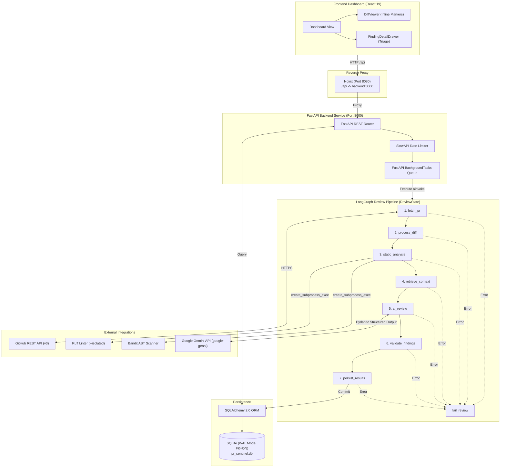

# PR Sentinel

> **Automated, High-Precision GitHub Pull Request Review Platform Combining Deterministic Static Analysis with Google Gemini and LangGraph.**

[](https://www.python.org/downloads/)
[](https://fastapi.tiangolo.com/)
[](https://react.dev/)
[](https://github.com/langchain-ai/langgraph)
[](docs/DEMO_CHECKLIST.md)
[](LICENSE)

---

## 1. Problem Statement & Motivation

Modern engineering teams spend hours reviewing pull requests. While linters catch basic formatting errors and generic LLM chatbots can comment on code, existing AI review tools suffer from severe flaws:
- **Hallucinations**: Generative models frequently reference nonexistent files or invent line ranges.
- **Alert Fatigue**: Raw LLM output often repeats trivial linter warnings, creating noise.
- **Security Vulnerabilities**: Naive chatbots can be jailbroken via prompt injection embedded directly in diff patches or commit messages.
- **Lack of Verification**: Chatbots cannot verify whether their suggested fixes are syntactically sound or anchored to actual changed code.

**PR Sentinel** bridges this divide. It treats code review as an engineering pipeline rather than an unstructured chat prompt. By running deterministic static analysis first (Ruff, Bandit), providing surrounding AST symbol context, orchestrating Google Gemini within a stateful LangGraph state machine, and strictly verifying every finding against verbatim patch lines, PR Sentinel delivers verifiable, hallucination-free code reviews.

---

## 2. Key Features

- **Multi-Engine Static Analysis**: Dispatches `Ruff` (linter/formatter) and `Bandit` (security scanner) in ephemeral workspaces with strict `--isolated` flags, preventing untrusted repository configurations from executing arbitrary code.
- **Deterministic Context Retrieval**: Analyzes Python ASTs to extract class and function definitions from modified and referenced files, providing surrounding context with zero vector embedding latency or drift.
- **LangGraph Review State Machine**: Coordinates review lifecycles across 7 fault-tolerant stages (`fetch_pr` &rarr; `process_diff` &rarr; `static_analysis` &rarr; `retrieve_context` &rarr; `ai_review` &rarr; `validate_findings` &rarr; `persist_results`).
- **Hallucination Defense**: Programmatically verifies every finding against the diff patch: line bounds must overlap changed lines, and code evidence must match repository contents verbatim.
- **Fingerprint Deduplication**: Merges static scanner alerts and AI observations on the same line into unified, collision-resistant records using SHA-256 fingerprinting.
- **Developer-Centric React 19 Dashboard**: Interactive diff viewer with inline gutter annotations, side drawer for finding inspection, finding triage state machine (`open` &rarr; `approved` / `dismissed`), and resilient polling.
- **Hardened Security Architecture**: Strict SSRF URL validation, Windows reserved device driver filtering, prompt injection delimiter neutralization, SlowAPI rate limiting, and pattern-based secret redaction.

---

## 3. Architecture Overview



For complete technical details, state models, and sequence diagrams, see [docs/ARCHITECTURE.md](docs/ARCHITECTURE.md).

---

## 4. Technology Stack

| Layer | Technologies & Libraries |
| :--- | :--- |
| **Frontend** | React 19, TypeScript, Vite, Tailwind CSS, React Router DOM v7, Lucide React, Vitest, React Testing Library, Oxlint |
| **Backend** | Python 3.12, FastAPI, Uvicorn, Pydantic v2, Pydantic Settings, SQLAlchemy 2.0, HTTPX, SlowAPI |
| **AI & Orchestration** | Google Gemini (Gemini 2.5 Pro / 3.5 Flash) via official `google-genai` SDK, LangGraph (`StateGraph`) |
| **Static Analyzers** | Ruff (0.17.3), Bandit (1.9.4), ESLint sandbox runner |
| **Storage & Persistence** | SQLite 3 (WAL mode, FK=ON), PostgreSQL (Psycopg 3.3.8, connection pooling, SQLAlchemy 2.0 URL normalization) |
| **Deployment & Cloud** | Render Infrastructure Blueprint (`render.yaml`, unified Docker Web Service), Multi-stage Docker (`python:3.12-slim`, `node:22-alpine`), Docker Compose 2.24.0+ |
| **CI / Automation** | GitHub Actions, Pytest, Pytest-Cov, Respx |

---

## 5. LangGraph Review Pipeline Stages

The review pipeline is executed asynchronously within a compiled `StateGraph` consuming and mutating a strongly typed `ReviewState`:

1. **`fetch_pr` (15%)**: Validates the PR URL format, parses owner/repo/number, and authenticates with GitHub REST API to fetch metadata and unified diff patches.
2. **`process_diff` (30%)**: Parses unified diffs into structured file objects and hunks. Filters out binary files, lockfiles, and minified code, enforcing a 50KB per-file diff limit and a 500KB total PR cap.
3. **`static_analysis` (50%)**: Writes changed files to an ephemeral temporary directory and executes `ruff` and `bandit` in parallel via isolated subprocesses with 30s timeouts.
4. **`retrieve_context` (65%)**: Scans Python ASTs for referenced classes and functions, extracting up to 50 symbol snippets (100KB cap) to provide surrounding context.
5. **`ai_review` (80%)**: Encloses diffs, context, and static findings into XML blocks with neutralized closing tags. Invokes Google Gemini with Pydantic structured schemas (`AIReviewResponse`), with single-repair retry on JSON errors.
6. **`validate_findings` (90%)**: Verifies that finding file paths exist, line ranges intersect modified code, and quoted evidence matches verbatim. Drops hallucinated alerts and deduplicates findings via SHA-256 fingerprints.
7. **`persist_results` (100%)**: Saves review records, file diffs, and deduplicated findings into SQLite. Updates token metrics and marks status as `COMPLETED`.

---

## 6. Screenshots & Visual Walkthrough

PR Sentinel includes real, verifiable Chrome DevTools Protocol (CDP) screenshots captured during end-to-end browser verification:

| View | Description | Screenshot |
| :--- | :--- | :---: |
| **Dashboard** | Overview of recent PR reviews, status badges, and quick review launcher. | [01_dashboard.png](docs/screenshots/01_dashboard.png) |
| **Review Detail** | Completed review showing progress stepper, findings breakdown, and metrics. | [05_review_detail.png](docs/screenshots/05_review_detail.png) |
| **Finding Drawer** | Slide-out panel displaying evidence, explanations, suggested fixes, and triage controls. | [06_finding_drawer.png](docs/screenshots/06_finding_drawer.png) |
| **Diff Viewer** | Unified diff viewer showing changed lines with clickable inline finding gutter markers. | [11_diff_viewer_markers.png](docs/screenshots/11_diff_viewer_markers.png) |
| **Finding Triage** | One-click state machine mutations (`approved`, `dismissed`, `reopened`) persisting across reloads. | [07_finding_approved.png](docs/screenshots/07_finding_approved.png) |
| **Polling Resilience** | Automatic UI recovery during unexpected backend restarts without page reload. | [15_polling_outage_retained.png](docs/screenshots/15_polling_outage_retained.png) |

For the complete 16-screenshot test sequence and synthetic demo notes, see [docs/DEMO_CHECKLIST.md](docs/DEMO_CHECKLIST.md).

---

## 7. Running with Docker

### Prerequisites
- Docker Engine (v24+) with **Docker Compose version 2.24.0 or later** (explicitly required because `docker-compose.yml` uses `env_file.required: false`).

### 1. Environment Configuration
Copy the provided environment template into the backend directory:
```bash
cp .env.example backend/.env
```
Edit `backend/.env` to configure your API keys:
- `GEMINI_API_KEY`: Google Gemini API key.
- `GEMINI_MODEL`: *(Optional)* e.g. `gemini-2.5-pro` or `gemini-3.5-flash`.
- `GITHUB_TOKEN`: *(Optional)* GitHub PAT for increased rate limits or private repos.

> [!IMPORTANT]
> Never commit `backend/.env` or credentials to version control. Build contexts strictly exclude `.env` files via `.dockerignore`.

### 2. Build and Start Services
```bash
# Build multi-stage Docker images
docker compose build

# Start services in the background
docker compose up -d
```

### 3. Accessing the Application
- **Frontend Dashboard**: [http://localhost:8080](http://localhost:8080)
- **Backend Health Check**: [http://localhost:8080/api/health](http://localhost:8080/api/health)
- **API Documentation**: [http://localhost:8080/docs](http://localhost:8080/docs) (Swagger UI)

### 4. Stopping Services
```bash
# Stop containers (preserves SQLite data volume)
docker compose down

# Stop containers and delete SQLite persistent volume
docker compose down -v
```

*(Note: Docker configuration and Compose YAML syntax have been statically verified; local container runtime execution is marked unverified on workstations without Docker installed.)*

---

## 8. Cloud Deployment with Render Blueprint

PR Sentinel includes an atomic Infrastructure-as-Code blueprint in [`render.yaml`](render.yaml) for automated single-service deployment to **Render**:

- **Unified Web Service (`pr-sentinel`)**: Multi-stage Docker container (`Dockerfile.render`) building the React 19 SPA with Node.js 22 and running the FastAPI backend on Python 3.12, serving both UI assets and REST API endpoints from a single domain and port.
- **SPA Static Serving (`SERVE_FRONTEND=true`)**: FastAPI serves compiled UI assets from `/app/frontend/dist` with deep link SPA fallback to `/index.html` without shadowing `/api/*`, `/docs`, `/redoc`, or `/openapi.json`.
- **Proxy Headers & Rate Limiting**: Uvicorn runs with `--workers 1 --proxy-headers --forwarded-allow-ips="*"` behind Render's edge proxy, ensuring IP-based rate limiting accurately keys on the real client IP.
- **Cost Protection**: Rolling 24-hour review limit (`MAX_REVIEWS_PER_DAY=20`) counts all review submissions (including failed runs) within a serialized process mutex to protect the Gemini LLM budget.
- **Access Control**: Optional shared bearer token gate (`APP_ACCESS_TOKEN`) with browser `sessionStorage` isolation and automatic `<AccessTokenModal />` re-authentication.

For database persistence caveats (free tier SQLite ephemerality and 30-day PostgreSQL expiry), Psycopg 3 setup, and step-by-step instructions, see [docs/DEPLOYMENT.md](docs/DEPLOYMENT.md).

---

## 9. Local Development Setup (Without Docker)

### Prerequisites
- Python 3.12+
- Node.js 22+ and npm

### 1. Backend Setup
```powershell
cd backend
python -m venv .venv
.\.venv\Scripts\Activate.ps1
pip install --upgrade pip
pip install -r requirements-dev.txt

# Create environment configuration
Copy-Item ..\.env.example .env

# Run FastAPI backend with hot-reload on port 8000
uvicorn app.main:app --host 127.0.0.1 --port 8000 --reload
```

### 2. Frontend Setup
```powershell
cd frontend
npm install

# Start Vite development server on port 5173 (proxies /api -> 127.0.0.1:8000)
npm run dev -- --host 127.0.0.1 --port 5173
```

### 3. Automated Dev Server Launcher
```powershell
# Launches backend (port 8000) and frontend (port 5173) in separate windows:
.\scripts\dev.ps1 -LaunchWindows
```

---

## 10. Testing & Quality Gates

PR Sentinel includes a comprehensive, verified test suite with **476 total passing tests** (100% pass rate, 1 skipped when `TEST_DATABASE_URL` is unset):

```powershell
# 1. Run Complete Backend Test Suite (420 Tests Passed, 1 Skipped)
backend\.venv\Scripts\pytest.exe -q backend\tests

# 2. Run Complete Frontend Test Suite (56 Tests across 15 files)
cd frontend
npm test -- --run

# 3. Run Static Linters and Security Scanners
backend\.venv\Scripts\ruff.exe check backend
backend\.venv\Scripts\ruff.exe format --check backend
backend\.venv\Scripts\bandit.exe -r backend/app -q
npm --prefix frontend run lint
npm --prefix frontend audit --omit=dev

# 4. Automated Security Verification Pipeline
.\scripts\security-check.ps1
```

### Test Suite Breakdown:
- **Backend Integration Tests (75 tests)**: GitHub client, LangGraph workflow, reviews API, findings API, settings API, rate limiting, daily review limits (rolling 24h window, boundary checks, failed run accounting, restart persistence) & multi-threaded concurrency safety, OpenAPI contract, and failure drills.
- **Backend Unit Tests (182 tests, 1 skipped)**: Diff parsing, file filters, keyword retriever, static analysis mapping, Gemini prompts, reviewer fallback, persistence, Psycopg 3.3.8 database URL normalization, typed URL safety validation with credential bypass rejection, and deduplication (1 live DB test skips cleanly when `TEST_DATABASE_URL` is absent).
- **Backend Security Tests (163 tests)**: SSRF prevention (67), path traversal confinement and SPA static-file containment with sibling collision and symlink rejection (55), shared access token gating with X-Access-Token header (9), resource limits (7), prompt injection defense (6), code execution prevention (5), SQL injection protection (5), rate limiting with proxy headers / client IP partitioning & Dockerfile uvicorn proxy verification (5), and secret redaction (4).
- **Frontend Tests (56 tests across 15 files)**: Workflow rendering, polling recovery, triage optimistic updates, diff viewer markers, sessionStorage access token isolation (5), React DOM XSS script injection prevention (2), and accessible AccessTokenModal re-authentication dialog with form draft preservation and retry support (6).

---

## 11. Security Architecture & Threat Boundaries

PR Sentinel treats all repository files, commit messages, and diff patches as untrusted data:

- **SSRF Prevention**: Strict URL grammar rejecting non-`github.com` hosts, custom ports, userinfo credentials, and IP addresses. Outbound requests pinned to `https://api.github.com/` with HTTP redirects disabled (`follow_redirects=False`).
- **Path Traversal Defense**: All file analysis runs inside `tempfile.TemporaryDirectory` with strict `Path.is_relative_to` containment checks. Windows reserved device names (`CON`, `PRN`, `AUX`, `NUL`), NTFS Alternate Data Streams (`:$DATA`), and UNC paths are blocked.
- **Code Execution Prevention**: Static tools run via `asyncio.create_subprocess_exec` with sanitized environments (no application API keys). Zero `eval`, `exec`, `pickle`, or `shell=True` throughout the codebase.
- **Prompt Injection Defense**: All untrusted code is wrapped in XML envelopes with closing tags neutralized (`</diff>` &rarr; `&lt;/diff>`). Gemini is given **zero tools/function declarations**.
- **Secret Redaction**: Regex scrubbing filters automatically sanitize GitHub Classic/Fine-grained PATs, Google Gemini API keys, Bearer tokens, and Authorization headers in all logs and tracebacks.
- **Rate Limiting & Cost Protection**: SlowAPI restricts review submissions to 5 requests per minute per IP. An atomic rolling 24-hour limit (`MAX_REVIEWS_PER_DAY`) backed by an in-process mutex prevents runaway LLM quota exhaustion.
- **Access Control Gate**: Optional shared bearer token gate (`APP_ACCESS_TOKEN`) with constant-time verification (`secrets.compare_digest`) and tab-isolated browser `sessionStorage`.

For the full security architecture, threat model, and verification details, see [docs/SECURITY.md](docs/SECURITY.md).

---

## 12. API Documentation & Endpoints

| Method | Endpoint | Description |
| :--- | :--- | :--- |
| `GET` | `/api/health` | Health check endpoint verifying service and database status (Public). |
| `POST` | `/api/reviews` | Enqueues a new pull request review (Rate limited: 5/min, daily quota enforced). Returns HTTP 202. |
| `GET` | `/api/reviews` | Lists review history with status, repo metadata, and pagination. |
| `GET` | `/api/reviews/{id}` | Retrieves detailed review status, stage progress, tokens consumed, and summary. |
| `DELETE` | `/api/reviews/{id}` | Cascades deletion to review files and findings (Returns HTTP 204). |
| `GET` | `/api/reviews/{id}/files` | Lists modified files with hunk patches, additions, deletions, and skip reasons. |
| `GET` | `/api/reviews/{id}/findings` | Lists findings with filters for severity, category, status, and confidence. |
| `PATCH` | `/api/findings/{id}` | Updates finding triage status (`open`, `approved`, `dismissed`). |
| `GET` | `/api/settings` | Retrieves current application analysis thresholds and enabled categories. |
| `PUT` | `/api/settings` | Updates analysis limits, confidence thresholds, and Gemini model overrides. |

Interactive OpenAPI documentation is available at `http://localhost:8000/docs` or `http://localhost:8080/docs`.

---

## 13. GitHub Actions CI Overview

The repository includes an automated CI workflow in [.github/workflows/ci.yml](.github/workflows/ci.yml):
- **Least Privilege**: Restricted to `permissions: contents: read`.
- **Pinned Commit SHAs**: Actions are pinned to full 40-character SHAs (`actions/checkout@11bd71901bbe5b1630ceea73d27597364c9af683`, `actions/setup-python@42375524e23c412d93fb67b49958b491fce71c38`, `actions/setup-node@1d0ff469b7ec7b3cb9d8673fde0c81c44821de2a`).
- **Parallel Jobs**:
  1. `backend`: Python 3.12, dependencies, Ruff format check, Ruff lint, Bandit scan, Pytest (420 passed, 1 skipped + coverage).
  2. `frontend`: Node.js 22, `npm ci`, Oxlint, production build (`npm run build`), Vitest (56 tests), `npm audit --omit=dev`.
  3. `docker`: Validates `docker compose config` and builds Docker images without pushing to any registry.

*(Note: The workflow has been validated syntactically and structurally; live execution in a hosted GitHub repository is pending initial repository push.)*

---

## 14. Known Limitations & Trade-offs

1. **Single-Worker Process Mutex**: The atomic rolling review limit uses an in-process thread lock. In horizontally scaled or multi-worker deployments, a distributed locking mechanism (e.g. Redis Redlock or Postgres advisory lock) is required.
2. **Cloud Ephemeral Storage & Quota Reset**: On Render Free tier, local SQLite databases are erased upon service spin-down (15 min inactivity) or redeployment, resetting the daily review quota counter to zero. Free Render PostgreSQL databases expire and are deleted after 30 days. Paid PostgreSQL or a persistent disk is required for durable production retention and persistent daily quota tracking. Google Gemini hard quotas in Google Cloud Console provide an independent outer spending limit.
3. **Single-User Access Gate**: `APP_ACCESS_TOKEN` provides a shared bearer passphrase gate, not individual user accounts, audit attribution, or granular RBAC.
4. **In-Process Task Dispatch**: Background reviews run via FastAPI `BackgroundTasks`. Server restarts mark running reviews as interrupted (handled cleanly on restart, but lacks external persistent task queues like Celery).
5. **Python Dependency Vulnerability Auditing**: An automated Python dependency vulnerability audit (e.g. via `pip-audit`) was **NOT PERFORMED** offline due to tool unavailability in the local environment.
6. **Docker Runtime Verification**: Container execution was verified statically via configuration parsers; live container runtime was not tested locally due to the absence of the Docker daemon on the Windows workstation.

---

## 15. Future Roadmap

- [ ] **Distributed Queue Architecture**: Replace `BackgroundTasks` with Celery or Temporal backed by Redis for multi-worker distributed review processing.
- [ ] **Automated GitHub App Webhooks**: Listen to `pull_request.opened` webhooks and post verified findings directly as inline comments on GitHub.
- [ ] **Containerized MicroVM Sandboxes**: Run static linters inside ephemeral Firecracker microVMs or gVisor sandboxes for true kernel isolation.
- [ ] **Containerized Dependency Auditing**: Integrate automated `pip-audit` into the GitHub Actions CI pipeline.

---

## 16. Contributing & License

- **Contributing**: Please review [CONTRIBUTING.md](CONTRIBUTING.md) for local setup, testing, formatting, and branch conventions.
- **License**: PR Sentinel's original project code and architecture are licensed under the [MIT License](LICENSE). Copyright (c) 2026 shashi123exe.
- **Third-Party Attribution**: All third-party libraries, dependencies, icons, and frameworks (including React, Vite, Lucide icons, FastAPI, LangGraph, Google GenAI SDK, Ruff, Bandit, and ESLint) remain the property of their respective copyright holders and retain their original licenses (MIT, ISC, Apache-2.0, BSD-2-Clause, and BSD-3-Clause). PR Sentinel does not claim ownership of any third-party materials.
