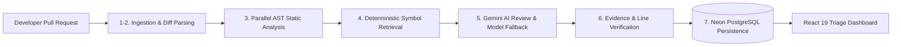
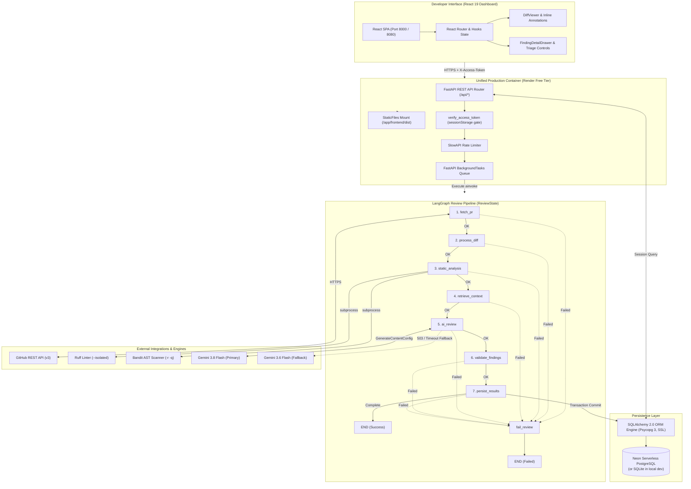
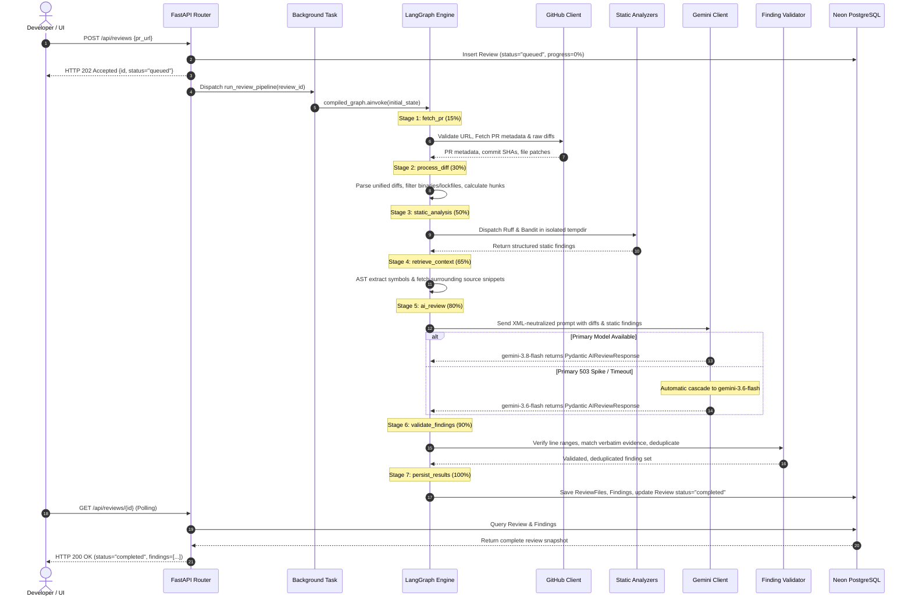
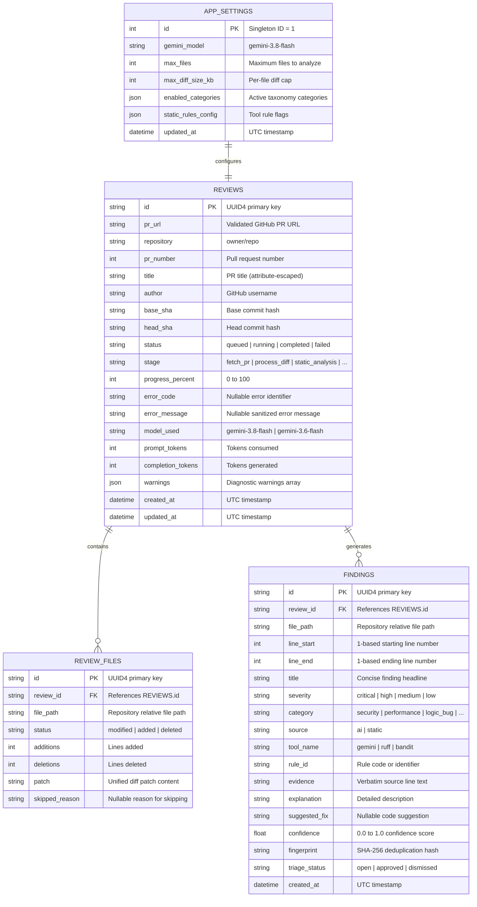

# PR Sentinel — Architecture & System Design Guide

- **Document Version:** 2.0.0
- **Status:** Verified & Production-Deployed
- **Live Deployment:** [https://pr-sentinel-btyl.onrender.com](https://pr-sentinel-btyl.onrender.com)
- **Repository:** [https://github.com/shashi123exe/pr-sentinel](https://github.com/shashi123exe/pr-sentinel)

---

## 1. System Overview

**PR Sentinel** is an automated, high-precision code review platform for GitHub Pull Requests. It bridges deterministic static analysis with generative AI reasoning by orchestrating linters (Ruff, Bandit), AST symbol extractors, and Google Gemini LLMs within an asynchronous, stateful **LangGraph** execution pipeline.



### Core Architectural Principles:
1. **Deterministic Static Foundation**: Fast linters and security scanners execute first via subprocesses in temporary working directories with stripped environments and 30s timeouts, detecting syntax bugs, unused imports, and common CWE vulnerabilities deterministically before AI evaluation.
2. **Deterministic Context (Zero Vector Drift)**: Code context retrieval parses Python ASTs across changed files to extract class and function definitions. This guarantees zero vector embedding latency, zero index drift, fully deterministic context windows, and zero cloud vector database costs.
3. **Structured & Verifiable AI Reasoning**: Google Gemini is constrained to strict Pydantic schemas (`AIReviewResponse`) via the official `google-genai` SDK. Zero tool/function declarations are provided. Every emitted finding must pass strict AST line-boundary checks and verbatim evidence matching against the actual diff patch before acceptance.
4. **Resilient Model Cascade & Quota Protection**: Upstream capacity pressure (HTTP 503) and request timeouts on the primary model (`gemini-3.8-flash`) automatically cascade to `gemini-3.6-flash`. Permanent daily quota exhaustion (RPD) is distinguished from temporary throttling (RPM/TPM) and fails fast without wasteful retries.
5. **Defense-in-Depth Security**: Untrusted repository contents, branch names, and diffs are treated as hostile input: isolated from system command shells, enclosed in neutralizing XML envelopes, inspected within temporary working directories with repository config exclusions and 30s timeouts, and stripped of raw credentials.

---

## 2. End-to-End System Architecture



---

## 3. Seven-Stage LangGraph Review Pipeline

The review pipeline is modeled as a stateful, compiled `StateGraph` consuming and mutating a strongly typed `ReviewState`:



### Stage Responsibilities & Failure Policies:

| Stage # | Stage Node | Description | Failure Policy |
| :---: | :--- | :--- | :--- |
| **1** | `fetch_pr` | Parses and validates the GitHub PR URL. Authenticates with GitHub REST API to retrieve PR metadata (title, author, base/head SHAs) and file patches. | Terminal failure: Sets `failed=True`, records error code (`github_not_found`, `github_rate_limited`, `invalid_url`), routes to `fail_review`. |
| **2** | `process_diff` | Parses unified diff patches into structured `ProcessedFile` models. Calculates line counts and hunks. Filters out binaries, lockfiles, minified assets, and files exceeding size caps (50KB/file, 500KB total). | Non-fatal: Unsupported or oversized files are marked `skipped` with audit reasons (`oversized_diff`, `binary_file`, `lockfile`). |
| **3** | `static_analysis` | Writes modified source files to a temporary working directory (`tempfile.TemporaryDirectory`). Executes `ruff` (`--isolated`) and `bandit` (`-r -q`) as subprocesses with stripped environment variables, repository config exclusions, 30s timeouts, and 5MB output caps. | Resilient: Tool execution timeouts or errors are logged in `tool_errors`; pipeline continues safely. |
| **4** | `retrieve_context` | Analyzes Python ASTs of changed files to identify imported classes, functions, and variables. Fetches up to 50 context snippets (100KB total cap) from modified files or referenced repository symbols. | Resilient: Context retrieval failures do not block the review; empty context is passed to the AI stage. |
| **5** | `ai_review` | Constructs structured XML user prompts enclosing diffs, context, and static tool awareness data. Invokes Google Gemini using `google-genai` SDK with strict Pydantic output schemas (`AIReviewResponse`). Cascades to fallback model on demand spikes. | Resilient: If both models fail and static findings exist, workflow continues with warning `"AI review unavailable"`. If no static findings exist, review fails gracefully. |
| **6** | `validate_findings` | Runs all AI-generated findings through `FindingValidator`: verifies that `file_path` exists, confirms line numbers intersect modified diff ranges, and validates that quoted `evidence` matches file content verbatim. Discards unanchored findings and deduplicates overlapping static/AI issues by fingerprint. | Non-fatal: Dropped findings increment `dropped_findings_count` with audit reasons recorded. |
| **7** | `persist_results` | Persists `ReviewFile` records, `Finding` records, token accounting metrics (`prompt_tokens`, `completion_tokens`), and summary aggregations in Neon PostgreSQL via SQLAlchemy ORM. Transitions `Review.status` to `COMPLETED`. | Terminal on DB error: Routes to `fail_review` if commit fails. |
| **-** | `fail_review` | Terminal node triggered whenever any stage flags `state["failed"] = True`. Marks review status as `FAILED`, updates `error_code` and `error_message`, and halts execution cleanly. | Updates database and exits pipeline. |

---

## 4. Gemini AI Model Fallback & Quota Protection

The AI review component (`backend/app/ai/gemini_client.py`) implements a multi-tier resilience architecture:

```mermaid
flowchart TD
    Start["Invoke generate_review()"] --> AttemptPrimary["Attempt 1: gemini-3.8-flash"]

    AttemptPrimary -->|200 OK| Parse["Validate Pydantic Schema"]

    AttemptPrimary -->|401/403 Auth Error| AuthFail["Raise AppError (Immediate Failure, Zero Retries)"]
    AttemptPrimary -->|Permanent Quota (RPD)| QuotaFail["Raise AppError(ai_rate_limited) (Immediate Failure)"]

    AttemptPrimary -->|503 Unavailable or Timeout| RetryPrimary{"Attempt < 3?"}
    RetryPrimary -->|Yes| BackoffPrimary["Exponential Backoff + Jitter (2s, 4s)"] --> AttemptPrimary
    RetryPrimary -->|No| FallbackTrigger["Log Warning: Cascade to gemini-3.6-flash"]

    FallbackTrigger --> AttemptFallback["Attempt 1: gemini-3.6-flash"]
    AttemptFallback -->|200 OK| Parse
    AttemptFallback -->|503 or Timeout| RetryFallback{"Attempt < 3?"}
    RetryFallback -->|Yes| BackoffFallback["Exponential Backoff + Jitter"] --> AttemptFallback
    RetryFallback -->|No| Exhausted["Raise AppError(ai_unavailable, 503)"]

    Parse -->|JSON Schema Valid| Success["Return AIReviewResponse"]
    Parse -->|Invalid JSON| Repair["Single Attempt Repair Prompt"]
    Repair -->|Success| Success
    Repair -->|Fail| Exhausted
```

### Key Safety Mechanisms:
1. **Primary Model**: Pinned to `gemini-3.8-flash` in default configuration.
2. **Fallback Model**: Mapped via `FALLBACK_MODELS = {"gemini-3.8-flash": "gemini-3.6-flash"}`.
3. **Bounded Retries**: At most 3 attempts per model ($\le 6$ total requests), preventing infinite retry loops or quota exhaustion.
4. **Permanent Quota Detection**: Error strings containing `"requests per day"`, `"daily quota"`, or `"check your plan"` are recognized as daily limits (RPD) and fail fast without repeated requests.
5. **Prompt Injection Neutralization**: Closing XML delimiters (`</diff>`, `</file>`) inside untrusted diffs are entity-encoded to `&lt;/diff`.
6. **Zero Tool Calling**: No function declarations or tool configurations are supplied to the LLM, neutralizing tool-calling side effects.

---

## 5. Finding Validation & Deduplication Engine

To filter ungrounded LLM outputs and eliminate redundant alerts, PR Sentinel implements a two-stage verification and deduplication system:

### 1. Verbatim Evidence Verification (`backend/app/services/validation.py`)
Every finding emitted by Gemini is scrutinized by `FindingValidator`:
- **File Confinement**: `file_path` must exist within the pull request file manifest.
- **Diff Intersection**: The line range `[line_start, line_end]` must overlap with modified or added lines in the diff patch.
- **Verbatim Evidence Match**: The quoted `evidence` string must exist verbatim (or token-normalized) within the HEAD file source lines. If the model invents code not present in the repository, the finding is immediately rejected.
- **Telemetry**: Rejected findings increment `dropped_findings_count` with explicit drop reasons (`unverifiable_evidence`, `nonexistent_file`, `disabled_category`).

### 2. Fingerprint Deduplication (`backend/app/services/dedupe.py`)
Static findings and AI findings are merged into a unified set using a deterministic fingerprint algorithm:
$$\text{Fingerprint} = \text{SHA256}(\text{normalized\_path} + ":" + \text{line\_start} + ":" + \text{category} + ":" + \text{normalized\_rule})$$
- When both a static tool (e.g. Bandit) and Gemini flag the same security defect on the same line, the findings are unified into a single record.
- The highest severity and confidence are preserved, and tool sources are attributed transparently (`source="ai"` or `source="static"`).

---

## 6. Database Schema & Persistence Architecture

PR Sentinel uses SQLAlchemy 2.0 ORM with dual-engine support: **Neon Serverless PostgreSQL** via Psycopg 3 in production, and **SQLite** (WAL mode, FK=ON) in local development:



---

## 7. Cloud Deployment & Container Architecture

PR Sentinel is deployed on Render's Free tier using an Infrastructure-as-Code blueprint ([render.yaml](../render.yaml)) and a unified multi-stage container ([Dockerfile.render](../Dockerfile.render)):

1. **Stage 1 (Frontend Build)**: Node.js 22 Alpine installs production dependencies, compiles TypeScript, and runs Vite build to generate minified SPA static assets (`dist/`).
2. **Stage 2 (Runtime Container)**: Python 3.12-slim installs backend dependencies (FastAPI, Uvicorn, LangGraph, Psycopg 3, Ruff, Bandit), copies the frontend `dist/` directory, and sets unprivileged runtime permissions.
3. **Single-Port Serving (`SERVE_FRONTEND=true`)**: FastAPI mounts the compiled frontend at the root path with client-side SPA fallback to `/index.html` without shadowing `/api/*` or documentation routes.
4. **Proxy Headers & Security**: Uvicorn runs behind Render's edge proxy with `--proxy-headers --forwarded-allow-ips="*"`. Security middleware enforces verified HTTP response headers:
   - `X-Content-Type-Options: nosniff`: Prevents MIME-type sniffing.
   - `X-Frame-Options: DENY`: Prevents clickjacking.
   - `Referrer-Policy: strict-origin-when-cross-origin`: Controls referrer information sent with requests.
5. **Response Compression**:
   - `GZipMiddleware`: Compresses HTTP response payloads exceeding 1000 bytes.
6. **Free-Tier Infrastructure**: Deployed using Render Free Web Service (512MB RAM) and Neon Free PostgreSQL, with Gemini AI review calls operating within Google GenAI free-tier rate limits and quotas subject to provider terms (without implying permanently zero cost or unlimited free usage).
7. **Verified Quality & Test Metrics**:
   - Backend: 433 passed, 1 skipped (93% line coverage across `app`).
   - Frontend: 56 passed across 15 test files (100% pass rate).
   - Combined: 489 passed, 1 skipped.
   - Multi-job CI verification: Frontend, Backend, and Docker Render build all green.
