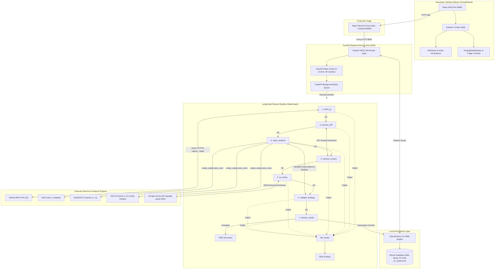
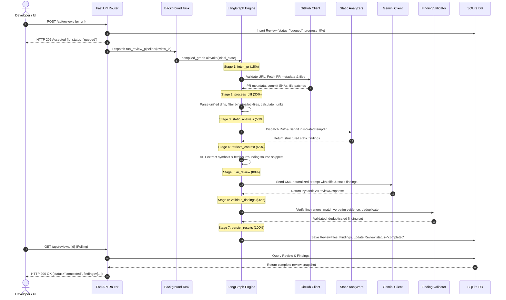
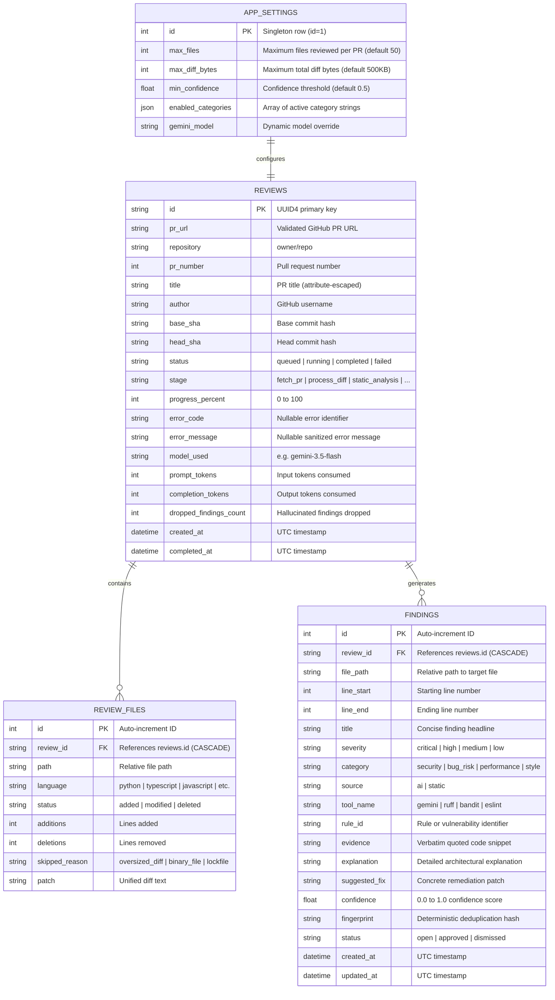

# PR Sentinel — Architecture & System Design Guide

- **Document Version:** 1.0.0
- **Phase:** 12 (Final System Architecture)
- **Status:** Approved & Verified Implementation

---

## 1. System Overview

**PR Sentinel** is an AI-powered GitHub Pull Request code review platform designed to deliver automated, high-precision, actionable code reviews. It bridges deterministic static analysis with generative AI reasoning by orchestrating linters (Ruff, Bandit, ESLint) and Google Gemini LLMs within an asynchronous, stateful **LangGraph** pipeline.

### Core Architectural Principles:
1. **Deterministic Static Foundation**: Linters and security scanners run first, catching syntax bugs, unused imports, and common vulnerabilities deterministically before AI evaluation.
2. **Deterministic Context (No Vector RAG)**: Code context retrieval uses AST keyword and symbol matching across changed files. This guarantees zero vector embedding latency, zero index drift, fully deterministic context windows, and low operational overhead.
3. **Structured & Verifiable AI Output**: Google Gemini is constrained to Pydantic structured schemas (`AIReviewResponse`). Zero tool/function declarations are provided to the model. Every emitted finding must pass strict AST line-boundary checks and verbatim evidence matching against the actual diff patch before acceptance.
4. **Defense-in-Depth Security**: Untrusted repository contents, branch names, and diffs are treated as hostile input. They are isolated from system command shells, enclosed in neutralizing XML envelopes, and inspected within ephemeral workspaces.
5. **Separation of Concerns**: A FastAPI backend exposes a clean REST API and manages review lifecycles; a modern React 19 dashboard provides real-time polling, inline diff inspection, and finding triage.

---

## 2. End-to-End System Architecture

The following diagram illustrates the complete architectural topology, data boundaries, and component interactions:



---

## 3. LangGraph Review Pipeline Stages

The review pipeline is modeled as a stateful, compiled `StateGraph` consuming and updating a typed `ReviewState`. Each stage represents a discrete, fault-tolerant processing step:



### Detailed Pipeline Stage Responsibilities:

| Stage # | Stage Node | Description | Failure Policy |
| :---: | :--- | :--- | :--- |
| **1** | `fetch_pr` | Parses and validates the GitHub PR URL. Authenticates with GitHub REST API to retrieve PR metadata (title, author, base/head SHAs) and modified file patches. | Terminal failure: Sets `failed=True`, records error code (`github_not_found`, `github_rate_limited`, `invalid_url`), routes to `fail_review`. |
| **2** | `process_diff` | Parses unified diff patches into structured `ProcessedFile` models. Calculates line addition/deletion counts and hunks. Filters out binary files, lockfiles, minified assets, and files exceeding size limits (50KB per-file cap, 500KB cumulative cap). | Non-fatal: Unsupported or oversized files are marked `skipped` with audit reasons (`oversized_diff`, `binary_file`, `lockfile`). |
| **3** | `static_analysis` | Writes modified source files to an ephemeral temporary directory (`tempfile.TemporaryDirectory`). Executes `ruff` (`--isolated`) and `bandit` (`-r -q`) as unprivileged subprocesses with 30s timeouts. Parses tool JSON outputs into `StaticFinding` models anchored to added lines. | Resilient: Tool execution timeouts or errors are logged in `tool_errors`; pipeline continues safely. |
| **4** | `retrieve_context` | Analyzes Python ASTs of changed files to identify imported classes, functions, and variables. Fetches up to 50 context snippets (100KB total cap) from modified files or referenced repository symbols to provide surrounding semantic scope. | Resilient: Context retrieval failures do not block the review; empty context is passed to the AI stage. |
| **5** | `ai_review` | Constructs structured XML user prompts enclosing diffs, context, and static tool awareness data. Invokes Google Gemini using `google-genai` SDK with strict Pydantic output schemas (`AIReviewResponse`). Applies single-repair retry on malformed JSON. | Resilient: Missing API key or API outages trigger fallback to static analysis findings, recording telemetry in `warnings`. |
| **6** | `validate_findings` | Runs all AI-generated findings through `FindingValidator`: verifies that `file_path` exists in the PR, confirms line numbers intersect modified diff ranges, and validates that quoted `evidence` matches file content verbatim. Drops hallucinated findings and deduplicates overlapping static/AI issues by fingerprint. | Non-fatal: Dropped findings increment `dropped_findings_count` with audit reasons recorded. |
| **7** | `persist_results` | Persists `ReviewFile` records, `Finding` records, token accounting metrics (`prompt_tokens`, `completion_tokens`), and summary aggregations in SQLite via SQLAlchemy ORM. Transitions `Review.status` to `COMPLETED` and sets `progress_percent=100`. | Terminal on DB error: Routes to `fail_review` if commit fails. |
| **-** | `fail_review` | Terminal node triggered whenever any stage flags `state["failed"] = True`. Marks review status as `FAILED`, updates `error_code` and `error_message`, and halts execution cleanly. | Updates database and exits pipeline. |

---

## 4. State Model & Data Contract

All data moving through the review pipeline is encapsulated in the typed `ReviewState` dictionary:

```python
class ReviewState(TypedDict, total=False):
    review_id: str                      # Unique UUID for the review execution
    pr_url: str                         # Verified canonical GitHub pull request URL
    parsed_pr: dict[str, Any] | None    # Owner, repo, and PR number
    pr_meta: dict[str, Any] | None      # PR title, author, commit SHAs, base/head refs
    changed_files: list[dict[str, Any]] # Raw file patch data from GitHub API
    processed_files: list[dict[str, Any]] # Parsed and filtered ProcessedFile objects
    hunks: list[dict[str, Any]]         # Structured diff hunks with line mappings
    static_findings: list[dict[str, Any]] # Normalised StaticFinding objects
    tool_errors: list[str]              # Non-fatal warnings from linters/scanners
    context_snippets: list[dict[str, Any]] # AST-retrieved code symbol snippets
    raw_ai_findings: list[dict[str, Any]]  # Unvalidated AIFinding models from Gemini
    validated_findings: list[dict[str, Any]] # Filtered, verified, deduplicated findings
    errors: list[dict[str, Any]]        # Error logs with stage attribution
    token_usage: dict[str, Any]         # Prompt tokens, completion tokens, model name
    truncation: dict[str, Any]          # Truncation flags and drop reasons
    warnings: list[str]                 # Diagnostic pipeline warnings
    dropped_findings_count: int         # Total count of hallucinated/invalid findings dropped
    failed: bool                        # Boolean flag routing conditionally to fail_review
```

---

## 5. Finding Validation & Deduplication Engine

To eliminate LLM hallucinations and redundant alerts, PR Sentinel implements a two-stage verification and deduplication system:

### 1. Verbatim Evidence Verification (`app/services/validation.py`)
Every finding emitted by Gemini is scrutinized by `FindingValidator`:
- **File Confinement**: Finding `file_path` must exist within the pull request file manifest.
- **Diff Intersection**: The finding line range `[line_start, line_end]` must overlap with modified or added lines in the diff patch.
- **Verbatim Evidence Match**: The quoted `evidence` string must exist verbatim (or token-normalized) within the HEAD file source lines. If the model invents code not present in the repository, the finding is immediately rejected.
- **Telemetry**: Rejected findings increment `dropped_findings_count` with explicit drop reasons (`unverifiable_evidence`, `nonexistent_file`, `disabled_category`).

### 2. Fingerprint Deduplication (`app/services/dedupe.py`)
Static findings and AI findings are merged into a unified set using a deterministic fingerprint algorithm:
$$\text{Fingerprint} = \text{SHA256}(\text{normalized\_path} + ":" + \text{line\_start} + ":" + \text{category} + ":" + \text{normalized\_rule})$$
- When both a static tool (e.g. Bandit) and Gemini flag the same security defect on the same line, the findings are unified into a single record.
- The highest severity and confidence are preserved, and tool sources are attributed transparently (`source="ai"` or `source="static"`).

---

## 6. Database Schema & Persistence Architecture

PR Sentinel stores all state locally in SQLite using SQLAlchemy 2.0 ORM with WAL (Write-Ahead Logging) and foreign key enforcement enabled:



---

## 7. Frontend SPA Architecture

The frontend is a single-page React 19 application built with TypeScript, Vite, Tailwind CSS, and Lucide React icons.

### Key Architectural Modules:
- **`AppRouter` (`src/App.tsx`)**: Configures client-side SPA routing (`/`, `/new`, `/history`, `/settings`, `/reviews/:reviewId`).
- **`DiffViewer` (`src/components/diff/DiffViewer.tsx`)**: Parses unified diff text into syntax-highlighted hunks, computing line numbers and embedding clickable inline gutter badges that link directly to findings.
- **`FindingDetailDrawer` (`src/components/findings/FindingDetailDrawer.tsx`)**: Slide-out drawer presenting finding metadata, verbatim code evidence, formatted explanations, suggested fixes, and triage controls (`open` &rarr; `approved` / `dismissed`).
- **`usePolling` Hook (`src/hooks/usePolling.ts`)**: Adaptive client polling engine (1s intervals during active stages) featuring exponential backoff, connection outage grace period banners, and automatic recovery upon server restarts.
- **`ApiClient` (`src/api/client.ts`)**: Strongly-typed HTTP wrapper communicating over relative `/api` paths. Compatible with both Vite development proxying and production Nginx reverse proxying.

---

## 8. Failure Recovery & Lifecycle Resiliency

PR Sentinel enforces automated recovery from infrastructure failures:
1. **Server Restart Recovery (`app/main.py::lifespan`)**: During application startup, a database scan identifies any reviews trapped in `running` status due to a previous ungraceful shutdown or crash. These stale reviews are automatically transitioned to `failed` with error code `server_restart` and an informative message.
2. **Frontend Polling Resilience**: If the backend restarts while the browser is polling an active review, the frontend displays an outage recovery banner, retains current UI state without blanking, and seamlessly reconnects once the backend listener resumes.
3. **Database Cascade Deletion**: Deleting a review via `DELETE /api/reviews/{id}` cascades cleanly to all associated `review_files` and `findings` records within a single database transaction.
