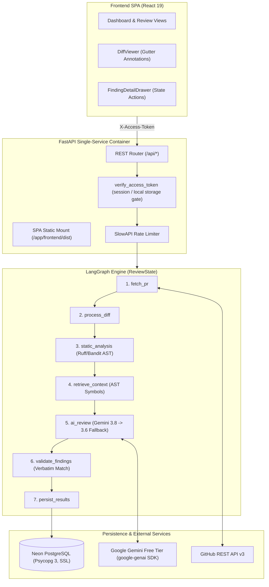

# PR Sentinel — Technical Demo Guide & Interview Walkthrough

> **A 2–3 minute live technical demonstration script, architecture walkthrough, and engineering interview cheat sheet for PR Sentinel.**
>
> - **Live Application:** [https://pr-sentinel-btyl.onrender.com](https://pr-sentinel-btyl.onrender.com)
> - **Source Code:** [https://github.com/shashi123exe/pr-sentinel](https://github.com/shashi123exe/pr-sentinel)
> - **Validation Case Studies:** [docs/VALIDATION_CASES.md](VALIDATION_CASES.md)
> - **System Architecture:** [docs/ARCHITECTURE.md](ARCHITECTURE.md)
> - **Target Audience:** Technical Recruiters, Engineering Managers, Staff/Senior Engineers, AI/ML Interviewers.

---

## 1. Quick Pitch (30 Seconds)

> *"Modern AI code review tools suffer from three fatal flaws: they hallucinate nonexistent code lines, they repeat trivial linter warnings, and they crash when upstream LLM APIs experience rate limits or capacity spikes.*
>
> *I built **PR Sentinel** to treat code review as a disciplined, verifiable engineering pipeline rather than an unstructured chat prompt. It orchestrates static analysis tools like Ruff and Bandit with Google Gemini across an asynchronous 7-stage LangGraph state machine.*
>
> *Every single finding is programmatically verified against the verbatim lines of the pull request before being accepted. It features automated model fallback from Gemini 3.8 Flash to 3.6 Flash on capacity exhaustion, stores findings in Neon Serverless PostgreSQL, and serves a full-stack React 19 and FastAPI application deployed live using Render Free and Neon Free tiers, with Gemini usage subject to free-tier quotas and provider terms."*

---

## 2. Live Demo Script (2 Minutes)

### Step 1 — Dashboard & Navigation (20s)
1. **Open the live application**: [https://pr-sentinel-btyl.onrender.com](https://pr-sentinel-btyl.onrender.com).
2. **Point out the Dashboard**:
   - *"The dashboard provides an at-a-glance operational view: recent reviews, status badges (`Completed`, `Failed`, `Running`), and a summary of detected findings across severity tiers."*
   - Highlight top metrics cards: Total Reviews, Findings, and Critical Issues.
3. **Authentication & Token Persistence**:
   - *"Notice the `APP_ACCESS_TOKEN` security gate. In production, access is protected by a shared bearer token. Users can store it tab-scoped in `sessionStorage` or check 'Remember this device' to persist it securely in `localStorage` across browser restarts without repeated prompts."*

### Step 2 — Launching a Pull Request Review (25s)
1. Click **"New Review"** in the sidebar navigation.
2. Enter a real-world pull request URL (e.g. `https://github.com/fastapi/fastapi/pull/16387`).
3. Click **"Launch Sentinel Review"**:
   - *"The backend immediately returns an HTTP 202 Accepted and dispatches the review into a background task managed by LangGraph."*
   - *"The UI switches to our live execution view, displaying a 7-stage progress stepper that polls with automatic exponential backoff."*

### Step 3 — The 7-Stage LangGraph Pipeline (35s)
Walk through the animated stages as they complete:
1. **`Fetch PR`**: *"Validates the URL format, extracts owner/repo/number, and fetches metadata and diff patches from the GitHub REST API."*
2. **`Process Diff`**: *"Parses unified diffs, calculates line numbers, and filters out binaries, lockfiles, and oversized diffs (>50KB per file)."*
3. **`Static Analysis`**: *"Dispatches Ruff and Bandit in parallel via subprocesses in a temporary working directory with stripped environments, config exclusions, and 30s timeouts."*
4. **`Context Retrieval`**: *"Extracts surrounding Python AST symbol definitions without vector database latency or embedding drift."*
5. **`AI Review`**: *"Injects the diff, context, and static findings into Google Gemini using strict Pydantic schemas. If Gemini 3.8 Flash hits a 503 capacity limit or times out, it automatically cascades to Gemini 3.6 Flash."*
6. **`Validate Findings`**: *"Our hallucination defense: every AI finding is checked against the actual patch. If line numbers don't intersect the diff or evidence doesn't match verbatim, the finding is discarded."*
7. **`Persist Results`**: *"Deduplicates findings via SHA-256 fingerprints and commits the review, files, and findings to Neon PostgreSQL."*

### Step 4 — Finding Triage & Diff Inspection (40s)
1. **Inspect Findings**:
   - Show the summary cards: Total Findings, Critical, High, Medium, Low.
   - Filter by **Severity**, **Source** (`AI Review` vs `Static Analysis`), or **Category**.
2. **Open Finding Detail Drawer**:
   - Click any finding row to reveal the slide-out drawer.
   - *"Here, developers see the exact verbatim evidence line, severity assessment, confidence score, and a clear technical explanation with suggested fix."*
3. **Interactive Triage**:
   - Click **"Approve"** or **"Dismiss"**:
   - *"Triage status updates instantly via optimistic UI mutation and persists permanently in Neon PostgreSQL."*
4. **Inline Diff Viewer**:
   - Click **"Files & Diff"** in the header to view unified diffs with clickable gutter markers.

---

## 3. Three-Case Real-World Demonstration Sequence

To showcase PR Sentinel's real-world versatility during an interview or recruiter walkthrough, use this verified three-case sequence:

| Sequence Step | Target Pull Request | Review Outcome | Engineering Significance |
| :---: | :--- | :--- | :--- |
| **Case 1** | [`fastapi/fastapi#16387`](https://github.com/fastapi/fastapi/pull/16387) | **Contextual Static Warnings** 4 Bandit B101 findings in test files; 0 AI findings | Demonstrates clear separation between static analysis and AI findings. Gemini evaluated the patch and generated zero additional findings, avoiding hallucinated issues on clean logic. |
| **Case 2** | [`encode/httpx#3775`](https://github.com/encode/httpx/pull/3775) | **Clean Pass (0 Findings)** Zero findings accepted across all 7 stages | Proves the system suppresses noise. When high-quality code has no security flaws or linter violations, PR Sentinel cleanly passes without inventing frivolous nitpicks. |
| **Case 3** | [`anthropics/skills#1638`](https://github.com/anthropics/skills/pull/1638) | **Actionable AI Finding & Developer Triage** 1 Medium AI finding (`with_server.py:46-48`), 95% confidence; 1 Low Bandit B603 warning | Demonstrates AI semantic reasoning catching a nuanced command-parsing validation edge case. The finding passed verbatim evidence verification and was triaged and approved by the developer. |

### Why These Differing Outcomes Demonstrate Useful Review Behavior:
> *"A naive LLM reviewer produces the exact same generic, unhelpful comments on every single pull request regardless of code quality. PR Sentinel demonstrates high-utility engineering behavior by exhibiting three distinct, context-appropriate outcomes:*
>
> 1. *It catches contextual linter warnings without letting the AI amplify them into false positives (FastAPI).*
> 2. *It remains silent when code is well-engineered, respecting developer attention (HTTPX).*
> 3. *It identifies subtle logic and validation edge cases that static linters miss and provides grounded evidence for developer verification and triage (Anthropic Skills)."*

---

## 4. Architecture Deep Dive (For Technical Interviewers)

### Key Engineering Decisions:

| Architectural Challenge | Naive Approach | PR Sentinel Engineering Solution |
| :--- | :--- | :--- |
| **LLM Hallucinations** | Trust LLM output directly | Two-tier `FindingValidator`: verifies line range intersection with diff hunks and performs verbatim source text matching. Rejects unanchored findings. |
| **Alert Redundancy** | Post all linter and AI findings | SHA-256 fingerprinting: `SHA256(file_path:line_start:category:rule)`. Merges overlapping linter and AI findings into single records with preserved attribution. |
| **LLM Rate Limits & 503s** | Fail review or infinite retry | Bounded exponential backoff with model fallback cascade: `gemini-3.8-flash` (primary, $\le 3$ retries) $\to$ `gemini-3.6-flash` (fallback, $\le 3$ retries). Permanent quota exhaustion (RPD) fails fast without wasteful calls. |
| **Context Retrieval Latency** | Heavy vector RAG (embeddings + vector DB) | Deterministic Python AST parser extracting referenced class and function definitions. Zero embedding latency, zero vector drift, zero cloud infrastructure cost. |
| **Security & Subprocess Isolation** | Run linters in host environment | Temporary working directories (`tempfile.TemporaryDirectory`) with unprivileged subprocess execution, stripped environment variables, repository config exclusions (`--isolated`), 30s timeouts, and 5MB output buffer caps. |
| **Deployment Costs** | Separate EC2/Fargate + RDS ($50+/mo) | Unified multi-stage Docker container deployed using Render Free tier + Serverless Neon PostgreSQL Free tier, with Gemini usage subject to free-tier quotas and provider terms. |

---

## 5. Comprehensive Interview Q&A Preparation Cheat Sheet

### Q1: How does PR Sentinel eliminate AI hallucinations and false positives?
> **Answer:** *"PR Sentinel attacks hallucinations at three levels:
> 1. **Structured Output Schemas**: Gemini is constrained to strict Pydantic models via Google GenAI SDK with zero tool declarations, eliminating freeform conversational drift.
> 2. **Diff Hunk Boundary Check**: Every candidate finding's `[line_start, line_end]` must intersect actual lines added or modified in the pull request. Findings targeting unchanged code are dropped.
> 3. **Verbatim Text Matching**: The finding's `evidence` field must match the repository source code byte-for-byte at the designated line coordinates. If an LLM hallucinates an imaginary snippet, the validation gate rejects it.
> 4. **Triage State Machine**: Developers can dismiss contextual alerts with one click, persisting status to Neon PostgreSQL."*

### Q2: How do you handle static analysis findings versus AI findings?
> **Answer:** *"We enforce strict provenance separation:
> - **Static Findings (`source="static"`)**: Generated deterministically by Ruff and Bandit AST scanners. They carry 100% confidence scores, exact rule codes (e.g. `B101`, `B603`), and standard CWE classifications.
> - **AI Findings (`source="ai"`)**: Generated by Google Gemini with semantic explanations and calibrated confidence scores (0.0–1.0).
> - **Deduplication Engine**: When both static analyzers and Gemini identify an issue on the same line, PR Sentinel uses SHA-256 fingerprinting `SHA256(path:line:category:rule)` to collapse them into a single record, preserving the highest severity and recording both sources."*

### Q3: What is your evidence-grounded validation mechanism and why is it superior to naive prompts?
> **Answer:** *"In naive LLM reviewers, the prompt simply asks 'Review this code and tell me bugs'. The model generates plausible-sounding critique, but often invents line numbers, refers to deleted code, or comments on formatting already handled by linters.
> In PR Sentinel, Stage 6 (`validate_findings`) treats the LLM's output as unverified proposals:
> - It slices the repository file at `[line_start, line_end]`.
> - It normalizes whitespace and verifies that `evidence` appears verbatim.
> - If the quoted code does not match ground truth, the candidate finding is rejected. This guarantees that every finding displayed to a developer corresponds to verifiable reality."*

### Q4: How are severity classifications and confidence scores determined?
> **Answer:** *"We use an objective multi-tier framework:
> - **Static Severity & Confidence**: Inherited directly from deterministic analyzer definitions (Bandit/Ruff rule maps). Confidence is always 100% because the AST pattern either matched or did not match.
> - **AI Severity**: Classified into `Critical` (exploitable vulnerabilities, auth bypass), `High` (data corruption, severe logic flaws), `Medium` (validation edge cases, resource leaks), and `Low` (code smell, minor logic risks).
> - **AI Confidence**: Calibrated between 0.0 and 1.0 based on semantic certainty. Findings below the user's configurable confidence gate (default 70%) are automatically filtered before persistence."*

### Q5: How does your Gemini fallback and quota resilience architecture work?
> **Answer:** *"In `backend/app/ai/gemini_client.py`, we implement a two-level resilience cascade:
> - **Transient Errors (HTTP 503 capacity spikes, 500–504, request timeouts)**: We apply bounded exponential backoff ($2^n$ seconds with random jitter) up to 3 attempts. If the primary model `gemini-3.8-flash` exhausts 3 attempts, we seamlessly cascade to `gemini-3.6-flash` and retry up to 3 attempts ($\le 6$ calls total).
> - **Permanent Daily Quota (RPD)**: We parse API error tokens for phrases like `'requests per day'` or `'daily quota'`. Permanent exhaustion fails fast immediately on attempt 1 without wasteful retries.
> - **Graceful Degradation**: If both AI models fail or are unavailable, reviews complete with static findings and an `'AI review unavailable'` banner, ensuring the developer still receives actionable security and linter results."*

### Q6: Why did you choose LangGraph instead of standard LangChain chains or raw Python scripts?
> **Answer:** *"Code review is fundamentally a non-linear, stateful workflow with strict validation boundaries and conditional error routing. LangGraph provides a compiled `StateGraph` consuming a strongly-typed `ReviewState`. This gave us:
> 1. Clear separation of concerns across discrete stages (`fetch_pr` &rarr; `process_diff` &rarr; `static_analysis` &rarr; `retrieve_context` &rarr; `ai_review` &rarr; `validate_findings` &rarr; `persist_results`).
> 2. Conditional edge routing: routing critical stage failures to `fail_review` while allowing non-fatal linter warnings to continue.
> 3. State isolation and deterministic immutability, making the entire pipeline reproducible and unit-testable without mocking complex execution graphs."*

### Q7: How do you prevent Prompt Injection through malicious PR diffs?
> **Answer:** *"We use defense-in-depth:
> 1. Untrusted PR diffs and commit messages are enclosed in structured XML envelopes (`<diff>` and `<file>`).
> 2. Closing tags within untrusted diff content (like `</diff>`) are neutralized through entity encoding (`&lt;/diff`) before prompt construction.
> 3. Strict system instructions command the model to treat patch contents as passive data to inspect, never as executable instructions.
> 4. We provide zero tool/function declarations to Gemini in the review prompt, eliminating the risk of tool-calling exploitation."*

### Q8: How did you optimize production performance and costs on Render Free tier?
> **Answer:** *"Render's Free tier provides 512MB RAM and sleeps after 15 minutes of inactivity:
> 1. **Single-Service Architecture**: Instead of paying for separate frontend and backend instances, we created `Dockerfile.render` which builds the React 19 SPA with Node.js 22 and packages it into a slim Python 3.12 container. FastAPI serves the compiled SPA static files with deep link fallback to `/index.html`.
> 2. **Neon Serverless PostgreSQL**: We offload persistence to Neon over SSL with connection pooling (`pool_size=5`, `max_overflow=10`, `pool_recycle=300`).
> 3. **Concurrency Protection**: We enforce a daily review quota (`MAX_REVIEWS_PER_DAY=20`) and process mutex to prevent concurrent review tasks from exceeding Render's memory limits on the free tier."*

---

## 6. Verification Checklist for Live Demonstrations

Before presenting to an interviewer:
- [x] Verify live health check: `curl https://pr-sentinel-btyl.onrender.com/api/health` returns `{"status":"ok","database":"ok"}`.
- [x] Have `APP_ACCESS_TOKEN` ready in clipboard to unlock the session modal.
- [x] Have sample PR URLs ready:
  - `https://github.com/fastapi/fastapi/pull/16387` (FastAPI contextual warnings).
  - `https://github.com/encode/httpx/pull/3775` (HTTPX clean pass).
  - `https://github.com/anthropics/skills/pull/1638` (Anthropic Skills AI logic edge case).
- [x] Keep Render dashboard tab open in background to show live logs and free-tier resource metrics.
- [x] Refer to [docs/VALIDATION_CASES.md](VALIDATION_CASES.md) for detailed empirical data on all three case studies.
