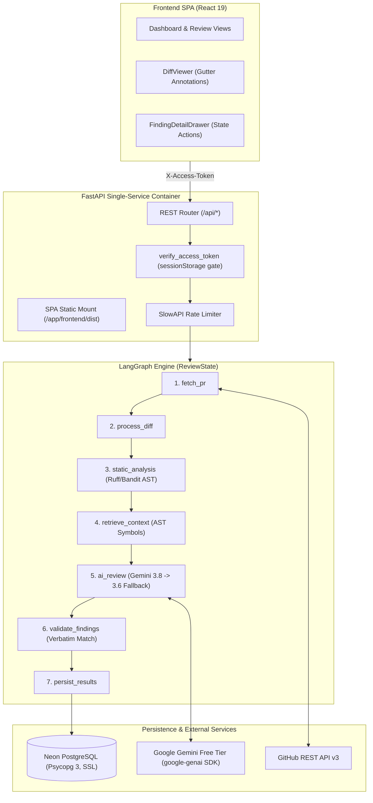

# PR Sentinel — Technical Demo Guide & Interview Walkthrough

> **A 2–3 minute live technical demonstration script, architecture walkthrough, and engineering interview cheat sheet for PR Sentinel.**

- **Live Application:** [https://pr-sentinel-btyl.onrender.com](https://pr-sentinel-btyl.onrender.com)
- **Source Code:** [https://github.com/shashi123exe/pr-sentinel](https://github.com/shashi123exe/pr-sentinel)
- **Target Audience:** Technical Recruiters, Engineering Managers, Staff/Senior Engineers, AI/ML Interviewers.

---

## 1. Quick Pitch (30 Seconds)

> *"Modern AI code review tools suffer from three fatal flaws: they hallucinate nonexistent code lines, they repeat trivial linter warnings, and they crash when upstream LLM APIs experience rate limits or capacity spikes.*
>
> *I built **PR Sentinel** to treat code review as a disciplined, verifiable engineering pipeline rather than an unstructured chat prompt. It orchestrates static analysis tools like Ruff and Bandit with Google Gemini across an asynchronous 7-stage LangGraph state machine.*
>
> *Every single finding is programmatically verified against the verbatim lines of the pull request before being accepted. It features automated model fallback from Gemini 3.8 Flash to 3.6 Flash on capacity exhaustion, stores findings in Neon Serverless PostgreSQL, and serves a full-stack React 19 and FastAPI application deployed live using Render Free and Neon Free tiers, with Gemini usage subject to free-tier quotas and provider terms."*

---

## 2. Live Demo Script (2 Minutes)

### Step 1 — Dashboard & Navigation (20s)
1. **Open the live application**: [https://pr-sentinel-btyl.onrender.com](https://pr-sentinel-btyl.onrender.com).
2. **Point out the Dashboard**:
   - *"The dashboard provides an at-a-glance operational view: recent reviews, status badges (`Completed`, `Failed`, `Running`), and a summary of detected findings across severity tiers."*
   - Highlight the top metrics cards: Total Reviews, Findings, and Critical Issues.
3. **Session Security Isolation**:
   - *"Notice the `APP_ACCESS_TOKEN` protection. In production, access is gated by a shared bearer token stored strictly in browser `sessionStorage` per tab—never written to persistent disk or localStorage, preventing cross-tab token leakage."*

### Step 2 — Launching a Pull Request Review (25s)
1. Click **"New Review"** in the top navigation.
2. Enter a real-world pull request URL:
   ```text
   https://github.com/fastapi/fastapi/pull/16387
   ```
3. Click **"Launch Sentinel Review"**:
   - *"The backend immediately returns an HTTP 202 Accepted and dispatches the review into a background task managed by LangGraph."*
   - *"The UI switches to our live execution view, displaying a 7-stage progress stepper that polls every 2 seconds with automatic exponential backoff."*

### Step 3 — The 7-Stage LangGraph Pipeline (35s)
Walk through the animated stages as they complete:
1. **`Fetch PR`**: *"Validates the URL format, extracts owner/repo/number, and fetches metadata and diff patches from the GitHub REST API."*
2. **`Process Diff`**: *"Parses unified diffs, calculates line numbers, and filters out binaries, lockfiles, and oversized diffs (>50KB per file)."*
3. **`Static Analysis`**: *"Dispatches Ruff and Bandit in parallel via subprocesses in a temporary working directory with stripped environments, config exclusions, and 30s timeouts."*
4. **`Context Retrieval`**: *"Extracts surrounding Python AST symbol definitions without vector database latency or embedding drift."*
5. **`AI Review`**: *"Injects the diff, context, and static findings into Google Gemini using strict Pydantic schemas. If Gemini 3.8 Flash hits a 503 capacity limit or times out, it automatically cascades to Gemini 3.6 Flash."*
6. **`Validate Findings`**: *"Our hallucination defense: every AI finding is checked against the actual patch. If line numbers don't intersect the diff or evidence doesn't match verbatim, the finding is discarded."*
7. **`Persist Results`**: *"Deduplicates findings via SHA-256 fingerprints and commits the review, files, and findings to Neon PostgreSQL."*

### Step 4 — Finding Triage & Diff Inspection (40s)
1. **Inspect Findings**:
   - Show the summary cards: Total Findings, Critical, High, Medium, Low.
   - Filter by **Severity**, **Source** (`AI Review` vs `Static Analysis`), or **Category**.
2. **Open Finding Detail Drawer**:
   - Click any finding row to reveal the slide-out drawer.
   - *"Here, developers see the exact verbatim evidence line, severity assessment, confidence score (100%), and a clear technical explanation with suggested fix."*
3. **Review Quality & Ground Truth**:
   - Point out the 4 findings on `tests/test_endpoint_context_shared_endpoint.py`:
     - *"These 4 findings flag Bandit rule B101 (assert used). In production code, assert is stripped by python -O, but in test suites, assert is standard practice. PR Sentinel accurately records these as low-severity static findings with 100% confidence, while Gemini evaluated the PR diff and generated zero additional findings on this audited pull request."*
4. **Interactive Triage**:
   - Click **"Approve"** or **"Dismiss"**:
     - *"Triage status updates instantly via a patch mutation and persists across reloads."*
5. **Inline Diff Viewer**:
   - Click **"Files & Diff"** in the header.
   - Point out the unified diff view with clickable gutter markers next to flagged lines.

---

## 3. Architecture Deep Dive (For Technical Interviewers)

When asked: *"How is PR Sentinel architected under the hood?"*



### Key Engineering Decisions:

| Architectural Challenge | Naive Approach | PR Sentinel Engineering Solution |
| :--- | :--- | :--- |
| **LLM Hallucinations** | Trust LLM output directly | Two-tier `FindingValidator`: verifies line range intersection with diff hunks and performs verbatim source text matching. Rejects unanchored findings. |
| **Alert Redundancy** | Post all linter and AI findings | SHA-256 fingerprinting: `SHA256(file_path:line_start:category:rule)`. Merges overlapping linter and AI findings into single records with preserved attribution. |
| **LLM Rate Limits & 503s** | Fail review or infinite retry | Bounded exponential backoff with model fallback cascade: `gemini-3.8-flash` (primary, $\le 3$ retries) $\to$ `gemini-3.6-flash` (fallback, $\le 3$ retries). Permanent quota exhaustion (RPD) fails fast without wasteful calls. |
| **Context Retrieval Latency** | Heavy vector RAG (embeddings + vector DB) | Deterministic Python AST parser extracting referenced class and function definitions. Zero embedding latency, zero vector drift, zero cloud infrastructure cost. |
| **Security & Subprocess Isolation** | Run linters in host environment | Temporary working directories (`tempfile.TemporaryDirectory`) with unprivileged subprocess execution, stripped environment variables, repository config exclusions (`--isolated`), 30s timeouts, and 5MB output buffer caps. |
| **Deployment Costs** | Separate EC2/Fargate + RDS ($50+/mo) | Unified multi-stage Docker container deployed using Render Free tier + Serverless Neon PostgreSQL Free tier, with Gemini usage subject to free-tier quotas and provider terms. |

---

## 4. Interview Q&A Preparation Cheat Sheet

### Q1: Why did you choose LangGraph instead of standard LangChain chains or raw Python scripts?
> **Answer:** *"Code review is fundamentally a non-linear, stateful workflow with strict validation boundaries and conditional error routing. LangGraph provides a compiled `StateGraph` consuming a strongly-typed `ReviewState`. This gave us:
> 1. Clear separation of concerns across discrete stages.
> 2. Conditional edge routing (e.g., routing any critical stage failure to `fail_review` while allowing non-fatal linter warnings to continue).
> 3. State isolation and deterministic immutability, making the entire pipeline reproducible and unit-testable without mocking complex execution graphs."*

### Q2: How do you handle transient Gemini failures vs. real quota exhaustion?
> **Answer:** *"In `backend/app/ai/gemini_client.py`, we implement a two-level classifier:
> - **Transient errors (503 capacity spikes, 500-504, request timeouts)**: We retry with bounded exponential backoff ($2^n$ seconds with random jitter) up to 3 attempts. If the primary model `gemini-3.8-flash` exhausts 3 attempts, we automatically switch the active model to `gemini-3.6-flash` and reset attempt counters.
> - **Permanent quota exhaustion (Daily limit, RPD)**: We parse API error tokens for phrases like `'requests per day'`, `'daily quota'`, or `'check your plan'`. Permanent exhaustion raises `AppError(code='ai_rate_limited')` immediately on attempt 1 without retries or switching models, avoiding wasted API calls.
> - **Authentication errors (401/403)**: Non-retryable errors fail immediately without fallback."*

### Q3: What happens if both Gemini models are down or rate-limited?
> **Answer:** *"PR Sentinel implements a graceful degradation policy. If both AI models fail or the API key is unconfigured:
> - If **static analysis findings exist** (from Ruff or Bandit), the workflow continues successfully, persists the static findings to Neon, and flags the review with an `'AI review unavailable'` warning banner. Developers still get actionable linter and security results.
> - If **no static findings exist and AI is unavailable**, the review marks itself as failed with `ai_unavailable`, preventing empty, unhelpful review runs."*

### Q4: How do you prevent Prompt Injection through malicious PR diffs?
> **Answer:** *"We use defense-in-depth:
> 1. Untrusted PR diffs and commit messages are enclosed in structured XML envelopes (`<diff>` and `<file>`).
> 2. Closing tags within untrusted diff content (like `</diff>`) are neutralized through entity encoding (`&lt;/diff`) before prompt construction.
> 3. Strict system instructions command the model to treat patch contents as passive data to inspect, never as executable instructions.
> 4. We provide zero tool/function declarations to Gemini in the review prompt, eliminating the risk of tool-calling exploitation."*

### Q5: How did you optimize production performance and costs on Render Free tier?
> **Answer:** *"Render's Free tier provides 512MB RAM and sleeps after 15 minutes of inactivity:
> 1. **Single-Service Architecture**: Instead of paying for separate frontend and backend instances, we created `Dockerfile.render` which builds the React 19 SPA with Node.js 22 and packages it into a slim Python 3.12 container. FastAPI serves the compiled SPA static files with deep link fallback to `/index.html`.
> 2. **Neon Serverless PostgreSQL**: We offload persistence to Neon over SSL with connection pooling (`pool_size=5`, `max_overflow=10`, `pool_recycle=300`).
> 3. **Concurrency Protection**: We enforce a daily review quota (`MAX_REVIEWS_PER_DAY=20`) and process mutex to prevent concurrent review tasks from exceeding Render's memory limits on the free tier."*

---

## 5. Verification Checklist for Live Demonstrations

Before presenting to an interviewer:
- [x] Verify live health check: `curl https://pr-sentinel-btyl.onrender.com/api/health` returns `{"status":"ok","database":"ok"}`.
- [x] Have `APP_ACCESS_TOKEN` ready in clipboard to unlock the session modal.
- [x] Have sample PR URL ready: `https://github.com/fastapi/fastapi/pull/16387`.
- [x] Keep Render dashboard tab open in background to show live logs and free-tier resource metrics.
- [x] Verified test suite status: 489 passed, 1 skipped (433 backend, 56 frontend; 93% backend coverage).
