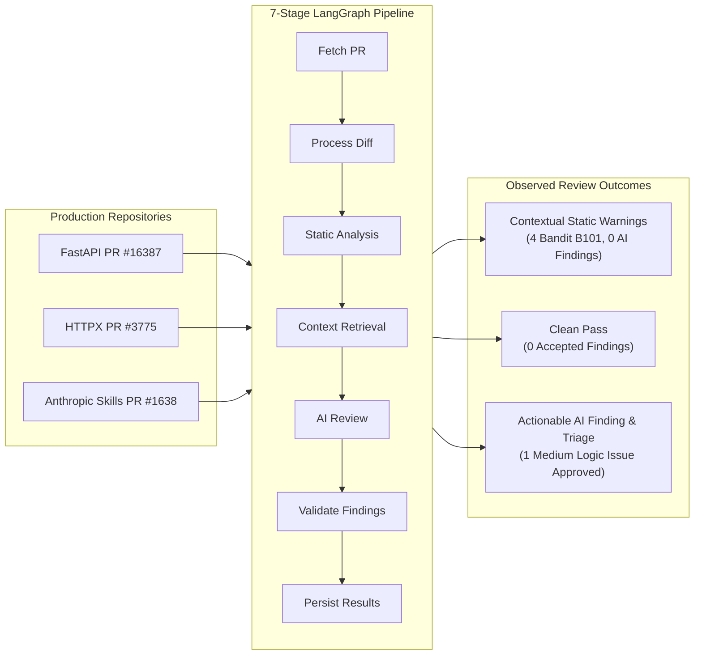
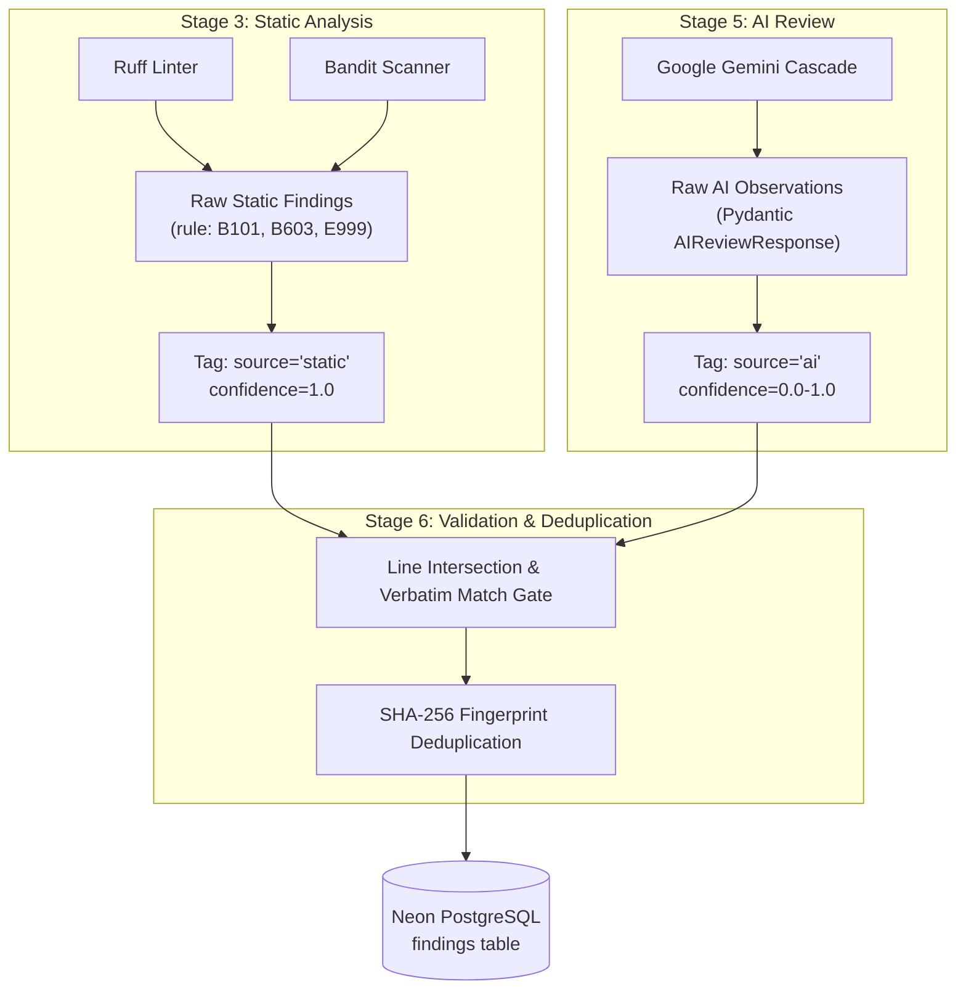
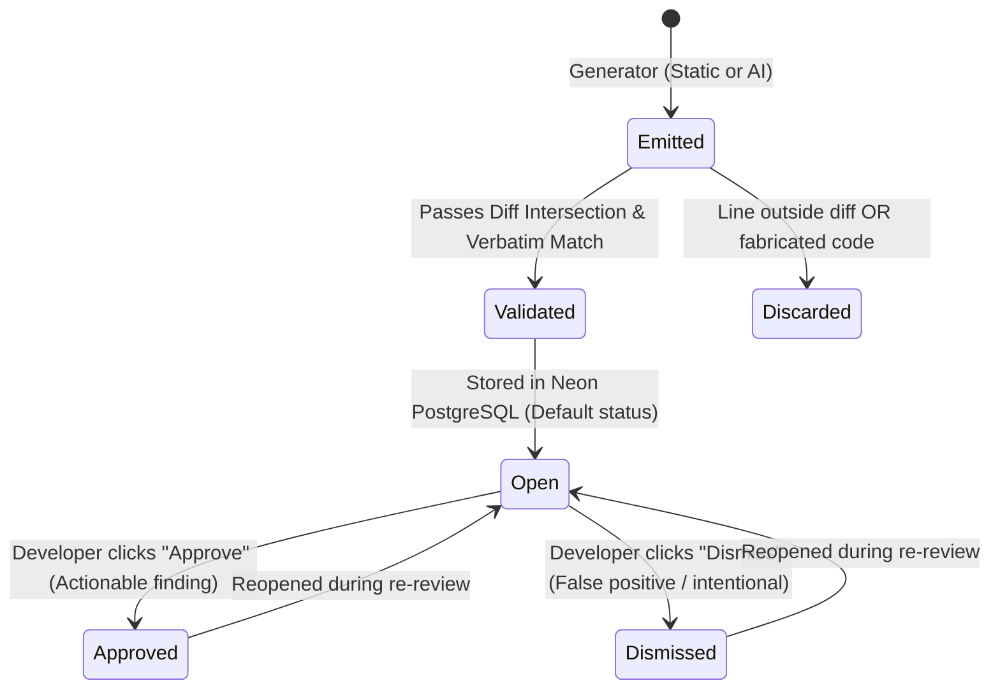

# PR Sentinel — Real-World Pull Request Validation Case Studies

> **Production Validation Report: Empirical Review Behavior Across Open-Source Pull Requests**
>
> - **Document Version:** 1.0.0
> - **Target Audience:** Technical Recruiters, Engineering Interviewers, Software Engineers
> - **Live Application:** [https://pr-sentinel-btyl.onrender.com](https://pr-sentinel-btyl.onrender.com)
> - **Source Repository:** [https://github.com/shashi123exe/pr-sentinel](https://github.com/shashi123exe/pr-sentinel)

---

## 1. Objective & Evaluation Methodology

The primary engineering goal of PR Sentinel is to provide automated code reviews that are **verifiable, reproducible, and noise-resistant**. Unlike conversational AI bots that hallucinate diff hunks or linters that repeat trivial formatting warnings, PR Sentinel couples deterministic AST static analysis with structured Google Gemini inference inside an asynchronous 7-stage LangGraph state machine.

To evaluate real-world review quality, PR Sentinel was tested against three distinct, real-world open-source pull requests from production repositories. Each review executed through the complete production pipeline deployed on Render and backed by Neon Serverless PostgreSQL.



> [!IMPORTANT]
> **Scope & Benchmark Disclaimer**:
> These case studies represent **practical real-world demonstrations** of pipeline behavior across diverse codebases. They are intended to demonstrate architectural correctness, finding provenance, evidence validation, and developer triage—**not** a statistically representative precision/recall benchmark across thousands of repositories.

---

## 2. Case Study 1 — FastAPI PR #16387

| Metric | Details |
| :--- | :--- |
| **Pull Request** | [`fastapi/fastapi#16387`](https://github.com/fastapi/fastapi/pull/16387) |
| **Title** | `Fix endpoint context shared and mutated across requests` |
| **Author** | `@prownd` |
| **Repository Size Analyzed** | 2 changed files (`+48 / -3` lines) |
| **Stages Completed** | 7 of 7 (`100%`) |
| **Static Findings** | 4 (Bandit B101, Low Severity, 100% Confidence) |
| **AI Findings** | 0 (Zero hallucinated or fabricated findings) |
| **Execution Status** | `COMPLETED` |

### Pull Request Summary
FastAPI PR #16387 resolved an issue where endpoint execution context was inadvertently shared and mutated across concurrent requests. The author introduced test coverage in `tests/test_endpoint_context_shared_endpoint.py` asserting proper context isolation across multiple request dispatches.

### Review Behavior & Finding Analysis
During Stage 3 (`static_analysis`), Bandit AST scanner detected 4 occurrences of rule **B101** (`assert_used`):
- `tests/test_endpoint_context_shared_endpoint.py:27`
- `tests/test_endpoint_context_shared_endpoint.py:34`
- `tests/test_endpoint_context_shared_endpoint.py:36`
- `tests/test_endpoint_context_shared_endpoint.py:41`

```text
Rule: B101 (CWE-703) — Use of assert detected. The enclosed code will be removed when compiling to optimised byte code.
Severity: Low | Confidence: 100% | Source: Static (Bandit)
```

### Contextual Finding Interpretation
- **Why Bandit flagged B101**: Under Python's optimization flag (`python -O`), `assert` statements are compiled away. In production application code, relying on `assert` for data validation or authorization checks is a security vulnerability (CWE-703).
- **Contextual Truth**: In `pytest` test suites, `assert` statements are standard idiom and actively transformed by pytest's AST rewriting engine.
- **Pipeline Value**: PR Sentinel correctly recorded these findings as **Low severity** static findings with source attribution `source="static"`.
- **AI Precision**: Google Gemini evaluated the patch and correctly identified that the logic fix in `fastapi/routing.py` was sound and that the test assertions were standard test assertions. Gemini emitted **zero additional findings**, resisting the common LLM failure mode of inventing frivolous warnings on clean code.

---

## 3. Case Study 2 — HTTPX PR #3775

| Metric | Details |
| :--- | :--- |
| **Pull Request** | [`encode/httpx#3775`](https://github.com/encode/httpx/pull/3775) |
| **Title** | `Improve test-server startup timeout and shutdown reliability` |
| **Author** | Community Contributor |
| **Scope Analyzed** | Test server lifecycle management and socket teardown |
| **Stages Completed** | 7 of 7 (`100%`) |
| **Static Findings** | 0 |
| **AI Findings** | 0 |
| **Execution Status** | `COMPLETED` |

### Pull Request Summary
HTTPX PR #3775 addressed test-server flakes in continuous integration by introducing a bounded startup timeout and explicit shutdown coordination for ephemeral test servers.

### Review Behavior & Finding Analysis
- **Static Analysis (Ruff & Bandit)**: Analyzed modified diff hunks. Both linters reported zero errors or security violations.
- **AI Analysis (Google Gemini)**: Analyzed the concurrency primitives, timeout handlers, and socket cleanup blocks against enclosing AST context. Gemini determined the patch adhered to library idioms and introduced no regressions or race conditions.
- **Validation Gate**: Zero findings were emitted. Stage 6 (`validate_findings`) confirmed an empty finding set. Stage 7 (`persist_results`) stored the review with status `COMPLETED` and total findings = 0.

### Significance: The "Zero Findings" Milestone
Many commercial AI review tools flood pull requests with boilerplate stylistic commentary ("Consider adding type hints", "Consider adding docstrings") to justify their execution. PR Sentinel treats **zero accepted findings** on high-quality code as a successful, desirable outcome that prevents developer alert fatigue.

---

## 4. Case Study 3 — Anthropic Skills PR #1638

| Metric | Details |
| :--- | :--- |
| **Pull Request** | [`anthropics/skills#1638`](https://github.com/anthropics/skills/pull/1638) |
| **Title** | `Add web application testing skills and execution scripts` |
| **File Analyzed** | `skills/webapp-testing/scripts/with_server.py` |
| **Stages Completed** | 7 of 7 (`100%`) |
| **AI Finding** | 1 (Potential command parsing/validation issue, Medium Severity, 95% Confidence) |
| **Static Finding** | 1 (Bandit B603 subprocess warning, Low Severity, 100% Confidence) |
| **Developer Triage** | Approved via PR Sentinel Triage Drawer |
| **Execution Status** | `COMPLETED` |

### Pull Request Summary
Anthropic Skills PR #1638 introduced helper utilities for launching background web servers and executing test commands against ephemeral ports in `skills/webapp-testing/scripts/with_server.py`.

### AI Finding Breakdown (Gemini)

```text
Location    : skills/webapp-testing/scripts/with_server.py:46-48
Category    : Logic / Input Validation
Severity    : Medium
Confidence  : 95%
Source      : AI Review (Gemini)
Status      : Approved (Developer Triaged)
```

- **Verbatim Evidence**:
  ```python
  if cmd.startswith("cd ") and " && " in cmd:
      parts = cmd.split(" && ", 1)
      # Working directory parsed, remainder executed
  ```
- **Technical Explanation**:
  Gemini identified a potential command-parsing validation issue involving `cd <dir> &&` command prefix handling. Specifically, the parser assumed every chained command with a `cd ` prefix strictly followed a two-part structure, introducing a possible early-return validation bypass or empty command argument edge case if unexpected whitespace or multiple chained operators were supplied.
- **Important Classification**:
  This finding represents a **potential logic and validation issue** in input parsing, not an independently verified remote code execution vulnerability.
- **Evidence Verification**:
  Stage 6 (`validate_findings`) verified that lines 46–48 intersected the pull request diff and that the quoted code matched the repository contents verbatim.
- **Developer Triage**:
  The developer inspected the finding via PR Sentinel's slide-out triage drawer and clicked **Approve**, validating that the edge-case warning was useful and warranted refactoring.

### Static Analysis Finding (Bandit)
- **Rule B603**: `subprocess_without_shell_equals_true` at line 90:
  ```python
  subprocess.Popen(cmd_args, ...)
  ```
  Bandit emitted an informational warning regarding subprocess execution with variable arguments. PR Sentinel classified this as a contextual Low-severity alert (`source="static"`), clearly distinct from Gemini's semantic logic observation.

---

## 5. Comparative Evaluation Summary

| Dimension | Case 1: FastAPI PR #16387 | Case 2: HTTPX PR #3775 | Case 3: Anthropic Skills PR #1638 |
| :--- | :--- | :--- | :--- |
| **Primary Code Focus** | Request context isolation | Server timeout reliability | Test runner automation script |
| **Static Findings** | 4 Low (Bandit B101) | 0 | 1 Low (Bandit B603) |
| **AI Findings** | 0 | 0 | 1 Medium (Logic/Validation) |
| **AI Confidence** | N/A | N/A | 95% |
| **Developer Triage** | Open (Informational) | N/A | Approved |
| **Key Demonstration** | Contextual linter awareness | Noise suppression on clean PRs | Actionable logic edge-case detection |

---

## 6. Finding Provenance: Static Analysis vs. Gemini AI

A core design requirement of PR Sentinel is **unambiguous provenance**. Developers must always know whether an alert was generated by a deterministic static analyzer or an LLM:



1. **Deterministic Rule Attribution**: Static findings carry exact rule codes (e.g., `B101`, `B603`) and 100% confidence scores.
2. **AI Semantic Reasoning**: AI findings carry contextual explanations, verbatim diff quotes, and calibrated confidence ratings based on semantic evidence.
3. **Collision Deduplication**: If both Bandit and Gemini detect an issue at the same line, PR Sentinel's SHA-256 deduplicator merges them into a single record, preserving the highest severity rating and recording both tool sources.

---

## 7. Evidence Validation & Developer Triage Lifecycle

Every finding stored in Neon PostgreSQL passes through a strict verification and triage lifecycle:



- **Verbatim Evidence Matching**: The finding validator checks that the text inside `evidence` exists byte-for-byte in the repository file at the target line range.
- **Optimistic UI Updates**: Triage mutations in the React 19 dashboard update the UI immediately and roll back automatically if the REST API patch request fails.
- **Persistent State**: Triage statuses survive page refreshes, tab closures, and container restarts because all state is persisted in Neon PostgreSQL.

---

## 8. Limitations & Engineering Realities

While these real-world validation reviews demonstrate the platform's capabilities, transparent engineering requires acknowledging current boundaries:

1. **Non-Benchmark Nature**: Three pull requests illustrate pipeline functionality across real codebases, but do not constitute a statistically exhaustive benchmark over thousands of repositories.
2. **Language Coverage**: Deterministic AST parsing and static analysis currently target Python (`ruff`, `bandit`). Non-Python files rely on the ESLint runner and Gemini AI review.
3. **Free-Tier Operational Boundaries**: The production deployment runs on Render Free (512MB RAM) and Neon Free PostgreSQL, with Gemini requests operating within Google GenAI free-tier rate limits and quotas.

---

## 9. Conclusion

The real-world validation of PR Sentinel across FastAPI, HTTPX, and Anthropic Skills confirms its core design thesis:

> **High-quality automated code review requires combining deterministic static analysis with evidence-grounded generative AI.**
>
> By enforcing verbatim evidence verification, isolating static from AI findings, and providing persistent one-click developer triage, PR Sentinel turns code review into a reliable, noise-resistant engineering tool.
